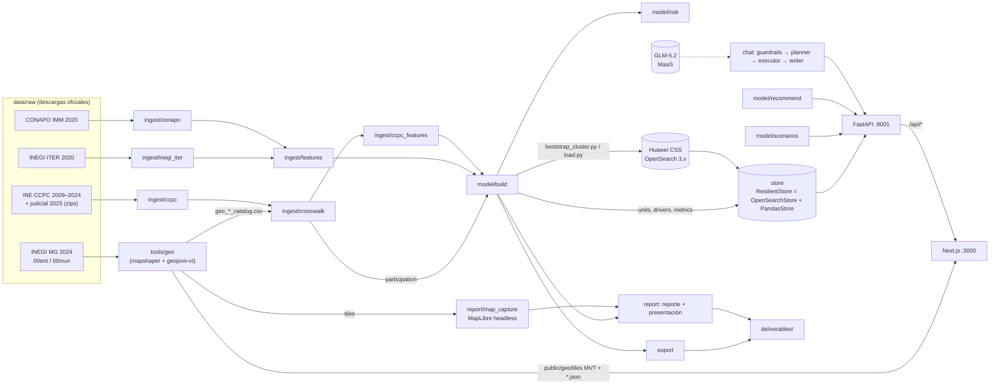

# ATALAYA — Riesgo de abstención en México

> **Fuente de verdad del proyecto.** Describe para qué sirve la app, cómo está construida y qué módulo implementa cada funcionalidad, tal como está hoy. Si el código y este documento discrepan, se corrige el que esté mal.

---

## 1. Propósito

Propuesta para el **Hackathon INE 2026 «Hackea la participación: Datos que construyen democracia»**, **Reto 2: Predicción y escenarios de riesgo de abstención** (analítica predictiva, sin datos personales).

- **Pregunta guía:** *¿Qué zonas podrían presentar mayor abstención en el futuro si no se interviene?*
- **Para qué le sirve al INE:** planeación anticipada y priorización estratégica de recursos rumbo a la elección federal del **6 de junio de 2027**.
- **Fuente obligatoria:** la convocatoria exige aprovechar la **Plataforma de Conteos Censales de Participación Ciudadana (CCPC) 2009–2024** del INE; ATALAYA la usa como fuente electoral única.

ATALAYA es un tablero y un conjunto de entregables que:

1. **Pronostica** la abstención de los **2,478 municipios** (Marco Geoestadístico INEGI 2024) y de los 32 estados para 2027.
2. **Clasifica** cada zona en un **semáforo** 🟢 verde · 🟡 amarillo · 🟠 naranja · 🔴 rojo que combina tendencia histórica y vulnerabilidad sociodemográfica, visible en un **mapa navegable** (país → estado → municipio).
3. **Simula escenarios**: *base* (sin intervención), *intervención* hipotética parametrizable y *pesimista*.
4. **Prioriza recursos** por **abstención esperada** (personas que se espera no voten) y propone **recomendaciones preventivas** por zona.
5. **Responde preguntas** con un asistente conversacional (GLM-5.2 en Huawei MaaS) que consulta los datos (motor de búsqueda **OpenSearch** en Huawei CSS, o memoria), nunca inventa cifras y está **acotado por guardrails**: solo responde sobre participación y abstención (rechaza código, asistencia general, jailbreaks, datos personales, temas partidistas y contenido dañino; ante autolesión ofrece la Línea de la Vida).
6. **Genera los entregables del reto**: reporte metodológico (PDF), presentación ejecutiva (PDF) con mapas renderizados por el mismo motor cartográfico de la app, mapa de escenarios (GeoJSON y visor HTML autónomo), figuras PNG y base de datos anonimizada (XLSX/CSV), empaquetados y verificados contra la convocatoria.
7. **Se publica en internet** como tablero dinámico (`http://46.250.172.193:8080`) detrás de un borde Caddy, con supervisor que reinicia cualquier componente caído.

**Principios:** solo datos agregados y disociados; supresión de celdas pequeñas; todo flujo con LLM tiene respaldo determinista; el clúster de búsqueda es **desechable** (se puede borrar y recrear: la app degrada a memoria en ~2 s y vuelve sola cuando el clúster nuevo está cargado); el mapa usa un motor WebGL dedicado (MapLibre GL) con teselas vectoriales de la geometría oficial INEGI, sin polígonos dibujados a mano; **la app se explica sola**: cada concepto de la interfaz lleva una ayuda ⓘ tomada de un único glosario, para que alguien del INE que nunca la ha visto entienda cada control y cómo se relaciona con los demás.

---

## 2. Arquitectura



| Capa | Tecnología | Ubicación |
|---|---|---|
| Ingesta y modelo | Python 3.12, pandas, numpy (sin scikit-learn) | `backend/atalaya/ingest`, `backend/atalaya/model` |
| Motor de búsqueda | **OpenSearch 3.x** en Huawei CSS (Basic auth, HTTPS), cliente `opensearch-py 3.0`; plantillas compuestas, índices versionados detrás de alias | `backend/atalaya/search_client.py`, `schema.py`, `load.py` |
| Almacén de consulta | `ResilientStore` (OpenSearch con respaldo automático) / `PandasStore` (parquet en memoria) | `backend/atalaya/store.py` |
| API | FastAPI + SSE | `backend/atalaya/api` |
| Asistente | Reglas deterministas + GLM-5.2 vía MaaS (API compatible OpenAI) | `backend/atalaya/chat`, `backend/atalaya/llm.py` |
| Entregables | openpyxl, GeoJSON, mapas renderizados con MapLibre en Chrome headless (CDP), gráficas SVG en Python, PDF con Chrome/Edge headless | `backend/atalaya/export.py`, `backend/atalaya/report` |
| Frontend | Next.js 16, React 19, Tailwind 4, MapLibre GL 5 (WebGL) con fuente vectorial MVT | `frontend/src` |
| Mapa base | Esri World Dark Gray Canvas (teselas ráster sin llave); tolera fallos aislados de teselas y, si el servicio cae, queda el contorno propio de México | `frontend/src/lib/mapStyle.ts`, `mapSupport.ts` |
| Geografía | mapshaper + geojson-vt + vt-pbf (Node) | `tools/geo` |
| Publicación | **Caddy 2.11** como borde público (puerto 8080) + supervisor Python con reinicio automático; tarea programada de Windows | `scripts/Caddyfile.template`, `backend/atalaya/ops/supervisor.py`, `scripts/serve_public.ps1` |
| Orquestación | PowerShell 5.1 | `scripts/*.ps1` |

---

## 3. Datos

### 3.1 Fuentes (`data/raw/`, no versionado; cómo obtenerlas en `README.md`)

| Carpeta | Contenido | Uso |
|---|---|---|
| `data/raw/ccpc/` | `DatosAbiertos_DECEyEC_ConteosCensales{2009,2012,2015,2018,2021,2024}.zip`, `…ConteosCensalesPJ2025.zip`, manual oficial | Participación por **sección × sexo × edad** (LN, SV, NV, NS) |
| `data/raw/inegi/` | `iter_00_cpv2020_csv.zip` | Población, edad, escolaridad, lengua indígena, servicios, internet, ruralidad |
| `data/raw/conapo/` | `IMM_2020.csv` | Marginación, analfabetismo, ingresos |
| `data/raw/geo/` | `00ent.*`, `00mun.*` (MG 2024, Lambert ITRF2008, latin-1) | Polígonos del mapa y catálogo canónico de municipios |

### 3.2 Definiciones clave

- **Participación CCPC = SV / (SV + NV)**: SV = registros con marca de voto, NV = sin marca, NS = no especificados (cuadernillo no disponible), excluidos. Reproduce el tablero oficial: nacional 44.06 / 62.08 / 47.07 / 62.37 / 51.84 / 59.67 % (2009–2024); judicial 2025 = 13.0 %.
- **Confiabilidad:** un municipio-año es confiable si `ns_rate = NS/LN ≤ 0.5` y participación ≥ 2 %; entre 0.3 y 0.5 es de baja confianza. Los no confiables (210 municipio-años federales) no se usan en el modelo y se muestran como "sin información confiable", nunca como 0 %.
- **Unidad canónica:** `cvegeo` (5 dígitos) del MG 2024; estado = `cve_ent`. El crosswalk INE→INEGI cubre el **100 %** de la lista nominal en todos los años.
- **Privacidad:** celdas edad × sexo con LN < 10 se suprimen (`suprimido=true`, conteos y tasa nulos); el sexo no binario solo se publica a nivel estatal y nacional.

### 3.3 Artefactos (`data/build/`, regenerables, no versionados)

| Archivo | Productor | Contenido |
|---|---|---|
| `participation_ine.parquet`, `ccpc_profile.parquet`, `ccpc_seccion.parquet` | `ingest/ccpc.py` | Agregados CCPC por municipio INE, por edad × sexo y por sección |
| `geo_mun_catalog.csv`, `geo_ent_catalog.csv` | `tools/geo/build_geo.mjs` | Catálogo canónico MG 2024 |
| `inegi_mun.parquet`, `conapo_mun.parquet`, `features.parquet` | `ingest/inegi_iter.py`, `conapo.py`, `features.py` | Variables sociodemográficas por `cvegeo` (2,478 filas; `new_since_2020` para municipios recientes) |
| `crosswalk.parquet`, `crosswalk_unmatched.csv` | `ingest/crosswalk.py` | Mapeo INE→INEGI (override → exacto → variantes → fuzzy) |
| `participation.parquet` | `ingest/crosswalk.py` | **Tabla canónica**: `cvegeo × año × elección` con LN, SV, NV, NS, `ns_rate`, `reliable`, `low_confidence` |
| `ccpc_profile_mun.parquet`, `ccpc_seccion_mun.parquet` | `ingest/crosswalk.py` | Perfil y secciones con `cvegeo` |
| `ccpc_features.parquet` | `ingest/ccpc_features.py` | Indicadores CCPC por municipio **y estado** (desde sumas) y elección: `pct_ln_18_34`, `part_18_34`, `gap_youth_pp`, `gap_sexo_pp`, `pct_ln_rural`, `ns_rate` |
| `units.parquet`, `drivers.parquet`, `metrics.json`, `model.json` | `model/build.py` | Pronóstico, semáforo, componentes, prioridad, factores y métricas |

Datos curados versionados en `data/seed/`: `states.csv` (estados y alias), `variables.csv` (catálogo para el asistente), `recommendations.csv` (reglas), `mun_crosswalk_overrides.csv`, `concurrencia_gubernatura.csv` (gubernaturas concurrentes 2009–2027; 17 en 2027).

---

## 4. Funcionalidades → módulos

### 4.1 Ingesta

| Qué hace | Dónde |
|---|---|
| Lectura robusta CSV/XLSX/ZIP (codificación, separador, fila de encabezado, normalización) | `ingest/common.py` → `read_table`, `norm_name`, `norm_col`, `pick_col`, `to_num`, `zpad`, `write_parquet` |
| CCPC: recorre los 32 CSV de cada zip con tipos fijos, agrega y descarta (≈ 9.8 M filas/año, ~11 s/año) | `ingest/ccpc.py` |
| Indicadores CCPC por municipio y estado | `ingest/ccpc_features.py` |
| ITER con `usecols` (nunca carga las 286 columnas); CONAPO con `CVE_MUN` sin cero inicial | `ingest/inegi_iter.py`, `ingest/conapo.py` |
| Universo MG 2024 + unión ITER/CONAPO | `ingest/features.py` |
| Crosswalk y tablas canónicas con confiabilidad | `ingest/crosswalk.py` |
| (Heredado, fuera del pipeline) resultados SICEE | `ingest/ine_results.py` |

### 4.2 Modelo de riesgo

**Pronóstico — participación relativa.** El nivel nacional cambia mucho entre elecciones y no es predecible con datos municipales, así que el modelo predice la **desviación** de cada municipio respecto a la media de la elección (`dev = 100·participación − media municipal`), usando solo municipio-años confiables (`model/panel.py`).

- **Candidatos** (`model/forecast.py`): `persist_l1` (desviación de la elección anterior), `persist_l2`, `mean_l1_l2` y `ridge` (rezagos + concurrencia con gubernatura + variables sociodemográficas y CCPC del año previo).
- **Backtest honesto:** entrena con T ≤ 2018 → prueba 2021; T ≤ 2021 → prueba 2024. Métricas: MAE (pp), RMSE, Spearman y acierto en el 20 % de mayor abstención. **Se elige el candidato de menor MAE promedio.**
- **Resultado actual:** gana `persist_l1` (MAE 5.95 / 6.05 pp; Spearman 0.84 / 0.81; acierto top-20 % 0.68 / 0.70). Los modelos con concurrencia y sociodemográficas no lo superan (el efecto de la concurrencia varía entre elecciones). Municipios sin rezago usan el siguiente candidato disponible (`fallback_model`).
- **Nivel 2027:** supuesto explícito = participación SV/(SV+NV) de la última intermedia confiable (2021, **51.84 %**); el pronóstico se **calibra** para que su agregado ponderado por LN sea exactamente ese nivel (`calibration_pp`). El semáforo compara zonas entre sí; el supuesto mueve el nivel absoluto, no el orden.
- **Intervalo:** ± 1.645·σ de los residuales del fold 2024.

**Perfil estructural — vulnerabilidad sociodemográfica.** Ridge de la desviación promedio en intermedias sobre variables de INEGI, CONAPO y CCPC. R² en validación cruzada aleatoria **0.32** (0.31 dentro de cada estado); el 47 % de la variación es entre estados, por lo que la validación que deja estados completos fuera da −0.08 (también se reporta). De aquí salen:
- `vulnerability_pp` (abstención relativa que predice el perfil de la zona),
- los **factores** por zona (`drivers.parquet`, contribución en pp a la abstención) y los coeficientes que muestra Metodología.

**CLI:** `python -m atalaya.model.build [--national-level X]`.

### 4.3 Semáforo

`model/risk.py` → `compute_risk`, `rescore`, `category_for`.

`risk_score = 100 · (0.50·rango(abstención pronosticada) + 0.20·rango(vulnerabilidad) + 0.15·rango(−tendencia) + 0.15·rango(volatilidad))`, rangos dentro de cada nivel. 🔴 ≥ 75 · 🟠 ≥ 55 · 🟡 ≥ 35 · 🟢 < 35 · ⚪ sin dato. Los componentes (`r_abs`, `r_vuln`, `r_trend`, `r_vol`) se guardan para explicar cada índice. `rescore` evalúa escenarios contra la distribución base.

Estado actual (base): 297 municipios rojos (12.9 % de la LN), 756 naranjas (49.5 %), 742 amarillos (29.2 %), 678 verdes (8.3 %), 5 sin dato.

### 4.4 Escenarios

`model/scenarios.py` → `SCENARIOS`, `default_params`, `simulate`.

| Escenario | Parámetros | Efecto |
|---|---|---|
| `base` | — | Pronóstico sin intervención |
| `intervencion` | `lever` (voto joven, casillas/traslado rurales, lenguas indígenas, campaña general; default voto joven), `targeting` (rojo / rojo+naranja / todos; default rojo+naranja), `effect_pp` 0–10 (default 3), `coverage` 0–100 % (default 100) | `Δ = efecto · cobertura · peso`, peso = variable de la palanca / su P75 (tope 1.5; 1 en campaña general); tope 98 % |
| `pesimista` | `shock_pp` 0–5 (default 2), `trend_amplifier` 0–100 % (default 50) | Empeora participación |

Las claves, rangos y defaults se publican en `/api/meta`; el frontend los toma de ahí (`lib/scenarioParams.ts`) y envía a cada escenario solo sus claves. Claves desconocidas se ignoran; valores fuera de rango ⇒ 422.

Resumen: zonas por color vs base, LN por color, votos adicionales/perdidos (`Δparticipación × LN`), cambio promedio en abstención y abstención esperada por escenario. Con los defaults: rojos 297 → 232, 1,053 municipios con Δ entre −4.5 y −0.9 pp, +1,744,296 votos.

### 4.5 Priorización y recomendaciones

- `abstencion_esperada = pred_abstention × lista_nominal`; `prioridad` = orden por abstención esperada dentro de zonas rojas y naranjas (encabezan Tijuana, Juárez, Puebla, León, Ecatepec).
- `model/recommend.py` + `data/seed/recommendations.csv`: 10 reglas (voto joven, accesibilidad de casillas, lenguas indígenas, educación cívica visual, difusión no digital, diagnóstico de caída sostenida, monitoreo por volatilidad, personas mayores, credencialización, coordinación en alta marginación) activadas por percentiles nacionales y por los factores de la zona; máximo 4 por zona. Un disparador por factor (`driver:<col>`) solo aplica si el valor de la zona está del lado desfavorable de la mediana nacional, según la columna `direction` (`low`/`high`) del CSV (p. ej. no sugiere difusión no digital a un municipio con buen acceso a internet).

### 4.6 Privacidad

`atalaya/privacy.py` → `suppress_small_cells` (LN < 10), `drop_nonbinary_below_state`. Se aplica en la API, el asistente y los entregables.

### 4.7 Motor de búsqueda OpenSearch y almacén de consulta

**Interfaz común** (`store.py` → `DataStore`): `units`, `unit`, `participation`, `profile`, `ccpc_features`, `search_units` (difusa, sin acentos, alias), `search_catalog`, `top`, `aggregate`, `correlation`, `drivers`, `metrics`, `stats`. `units` incluye columnas anchas `part_dip_<año>`/`abst_dip_<año>` para resolver correlaciones en un solo índice. Año por defecto: último federal (la judicial 2025 solo si se pide). Los rankings desempatan por `id` ascendente en ambos motores, así que memoria y OpenSearch devuelven exactamente el mismo orden.

| Pieza | Qué hace | Dónde |
|---|---|---|
| Configuración | `OPENSEARCH_URL` (coma-separado), `OPENSEARCH_USERNAME`, `OPENSEARCH_PASSWORD`, `OPENSEARCH_VERIFY_CERTS`, `OPENSEARCH_CA_CERTS`, `OPENSEARCH_TIMEOUT_S`, `OPENSEARCH_REPLICAS`; las `ES_*` antiguas funcionan como respaldo. `ATALAYA_STORE=auto\|opensearch\|memory`. `reload_env()` relee `backend/.env` en caliente | `config.py` → `Settings.search_*`, `get_settings`, `reload_env` |
| Cliente | `get_client()` (HTTPS, auth, compresión, 2 reintentos), `get_probe_client()` (sin reintentos, 2 s, para sondas), `ping`, `cluster_info` (distribución, versión, nodos, estado; nunca secretos), `auto_replicas` (min(1, nodos−1)), `ensure_index_templates`, `bulk_index` | `search_client.py` |
| Esquema | Plantillas **compuestas** `atalaya-<kind>` con patrón `atalaya-<kind>-*` (prioridad 200, `SCHEMA_VERSION=2`); analizadores `es_folded` (minúsculas + sin acentos + stop + stemmer ligero español) y `es_prefix`; `units.name` con subcampos `kw` (normalizado) y `sayt` (`search_as_you_type`) | `schema.py` → `TEMPLATES`, `ANALYSIS`, `template_body` |
| Store OpenSearch | Consultas con `request_timeout ≤ 10 s`; `search_units` combina `bool_prefix` sobre `name.sayt`, `match` difuso y término exacto normalizado (boost 10); agregaciones `terms/avg/percentiles`; **correlación con `matrix_stats`** y, si falla, Pearson en el cliente | `store.py` → `OpenSearchStore` |
| Resiliencia | `ResilientStore` envuelve OpenSearch + memoria perezosa: ante un error responde desde memoria y abre un circuito de 60 s; la primera sonda es síncrona (ping + existencia del alias, sin reintentos: ≤ 2.5 s) y las siguientes corren en un hilo daemon, de modo que ninguna petición espera al clúster. Expone `kind` (quién respondió), `degraded`, `last_error` (sin URL ni credenciales) | `store.py` → `ResilientStore` |
| Selección | `get_store()`: `memory` → `PandasStore`; `opensearch` o `auto` con URL configurada → `ResilientStore` (aunque el clúster esté caído o vacío al arrancar); sin URL → memoria | `store.py` → `get_store` |

**Carga a OpenSearch** (`load.py`): cada `kind` (`units` 2,510 docs, `participation` 17,445, `catalog` 28, `profile` 209,667) se carga en un índice físico `atalaya-<kind>-<YYYYmmddHHMMSS>` con réplicas 0 y refresco desactivado, se restauran réplicas y refresco, se verifica `count == docs` (si no, se borra el índice nuevo y el alias queda intacto) y se **cambia el alias `atalaya-<kind>` de forma atómica**; se conservan `--keep` versiones previas. `--reset` → `purge_prefixed` borra alias, índices y plantillas **solo** con el prefijo (nunca con comodín en el delete). Todo nombre pasa por `assert_prefixed`: el clúster es compartido.

**Clúster desechable** (`backend/scripts/bootstrap_cluster.py`): un solo comando deja listo un clúster nuevo o recreado — configuración (solo `host:puerto`) → conectividad con 5 reintentos → salud (espera a salir de `red`) → `--reset` opcional → carga completa en proceso → paridad OpenSearch vs memoria (`scripts/os_parity.py` → `run_checks`: conteos, unidad, búsqueda, rankings, agregados, correlaciones, perfil) → `POST /api/admin/reload` si la API corre. Exit 0 solo si todo pasó. Diagnóstico independiente: `scripts/check_cluster.py` (distingue sin URL / no alcanzable / 401).

### 4.8 Asistente conversacional

`api/chat.py` (`POST /api/chat`, SSE) orquesta `chat/`:

| Paso | Qué hace | Dónde |
|---|---|---|
| Guardrails de entrada | Revisión determinista, sin red (~14 ms), antes de cualquier LLM; ver tabla siguiente | `chat/guardrails.py` → `screen_input`, `sanitize_history` |
| Compuerta de tema | Solo si el mensaje no trae vocabulario del dominio, no es saludo y no es un seguimiento corto de una conversación en tema: LLM con respuesta VALID/REJECT; ante error deja pasar (sin LLM el redactor usa plantilla) | `chat/guardrails.py` → `topic_gate`, `has_domain_signal` |
| Saludos y ayuda | Saludos, agradecimientos y preguntas sobre la app o la privacidad van directo a la ayuda determinista (qué responde y qué no, privacidad, fuentes), sin LLM | `api/chat.py`, `chat/planner.py` (`_plan_rules`), `chat/executor.py` (`_execute_help`) |
| Plan | Reglas primero (años, estados, intent, métrica del catálogo; perfil por edad, juvenil, género, judicial, priorización). Las preguntas compuestas "X y Y" solo se dividen si no son de correlación o comparación. Los **municipios se resuelven con `store.search_units`** (búsqueda difusa sin acentos, priorizando el estado mencionado; p. ej. "Juárez, Chihuahua" → 08037). LLM (`chat_json`) solo si hace falta, y **todo `unit_id` que proponga se valida** contra el store y el texto (si no corresponde, se reemplaza o se descarta); respaldo a reglas | `chat/planner.py`, `chat/spec.py` |
| Ejecución | Sobre el store, sin LLM: ranking, lookup, compare, trend, correlation (r, n, quintiles), profile, scenario, explain_unit, catalog; aplica privacidad; los datos censales siempre se fechan en 2020 | `chat/executor.py` |
| Redacción | LLM en streaming (≤ 120 palabras, solo cifras de la tabla, fuente y año; alcance estricto; pregunta y datos cercados como contenido, nunca instrucciones). `help`/`out_of_scope` nunca llaman al LLM. La salida pasa por `StreamGuard`; si falla, lo bloquea el auditor de MaaS o el guardrail de salida, plantilla determinista (`degraded`) | `chat/writer.py` |

**Guardrails** (`chat/guardrails.py`, adaptados del módulo de guardrails de NOLI al dominio electoral):

| Capa | Qué detecta | Resultado |
|---|---|---|
| Normalización | Caracteres invisibles/bidi, homoglifos, *leet*, letras repetidas; decodifica base64/hex/rot13 y re-evalúa | Las reglas leen el texto "limpio" |
| Prompt shields | Anular instrucciones (ES/EN), revelar el prompt, modo desarrollador/DAN, "sin filtros", andamiaje de chat, cambio de rol; señales suaves solo cuentan de 2 en 2 y el encuadre hipotético ("imagina que el INE…") no cuenta en preguntas del dominio | `jailbreak` |
| Fuera de alcance | Pedir código/scripts/SQL (ES/EN, con faltas) aunque mencione el dominio; escritura creativa, traducción, recetas, chistes, tareas, deportes, clima | `codigo` / `fuera_de_alcance` |
| Privacidad y neutralidad | CURP, clave de elector, "quién votó", domicilio/teléfono de personas; partidos (siglas sensibles a mayúsculas), candidaturas, "quién ganará", intención de voto. No bloquea "dirección de la tendencia" ni "¿cuánta participación se ganará?" | `datos_personales` / `partidista` |
| Contenido dañino | Odio, sexual, violencia con objeto humano y **autolesión** (prioritaria; el rechazo siempre incluye la Línea de la Vida 800 911 2000 y el 911) | `danino:*` |
| Multimodal / longitud | Data URIs, etiquetas de medios, blobs codificados, > 30 líneas | `multimodal` / `longitud` |
| Vocabulario del dominio | Señales fuertes (participación, abstención, INE, casilla, municipio, semáforo, escenario, estados…) bastan con 1; débiles (estado, índice, edad, riesgo, nombres de municipio de una palabra…) requieren 2 | Decide si se consulta la compuerta de tema |
| Salida (`StreamGuard`) | Libera una oración completa a la vez (nunca corta en un punto decimal) y revisa código, fuga del prompt, contenido dañino, credenciales y **cifras no respaldadas**: cada número debe estar en los hechos/tabla/pregunta (tolerancia de redondeo, fracción ↔ %), o ser suma/diferencia de dos de ellos, un entero 0–10 o un año 2000–2030 (`ATALAYA_GUARD_GROUNDING=block|flag`) | Corta y completa con la plantilla de datos verificados |
| Listas personalizables | `data/seed/guardrail_lists.json` (bloqueo/regex de entrada y salida, permitidos), recarga en caliente | `blocklist` / `filtro_personalizado` |
| Auditoría | Una línea JSONL por decisión bloqueada o marcada en `data/cache/logs/guardrails.jsonl` (referencia `gr-xxxxxxxx`, etapa, categoría, regla, severidad, hash y longitud del mensaje; **nunca el texto**); contadores en `GET /api/admin/guardrails` | — |

Cada rechazo es un texto en español que explica el motivo sin revelar la regla y termina con su referencia `gr-…`. `chat/guard.py` queda como envoltura compatible (`check`).

Eventos: `plan` → `data` → `token`… → `done {sources, degraded, guardrail}`; ante un rechazo de entrada o de tema solo `token` + `done` (`guardrail = {stage, category, ref}`). Cliente LLM: `llm.py` (reintentos, razonamiento desactivado ≈ 4 s, detección del auditor de MaaS).

Verificación en vivo (`temp/optfix/tools/chat_guard_probe.py`, 56 casos con variantes en inglés, mayúsculas, faltas, emojis, leet, base64, inyección dentro de preguntas válidas y seguimientos con historial): **56/56** — 36/36 bloqueos correctos (≈ 14 ms, sin LLM salvo la compuerta de tema) y 20/20 preguntas legítimas respondidas sin intervención del guardrail.

### 4.9 API REST

`api/main.py` (app, CORS, warmup), `api/routes.py`, `api/deps.py` (caches).

| Método | Ruta | Devuelve |
|---|---|---|
| GET | `/api/health` | estado, `store` (`opensearch`\|`memory`), `store_degraded`, `search_engine` (distribución y versión, caché 60 s), LLM, conteos |
| GET | `/api/meta` | año objetivo, años, estados, escenarios, categorías, fuentes de datos |
| GET | `/api/risk?level&ent&scenario` | zonas con pronóstico, semáforo, vulnerabilidad, abstención esperada, prioridad |
| POST | `/api/scenario/simulate` | items + resumen (422 con mensaje si los parámetros son inválidos) |
| GET | `/api/region/{id}?scenario` | serie (con `reliable`, `ns_rate`, judicial aparte), variables vs mediana, factores, componentes del índice, escenarios, recomendaciones, perfil CCPC 2009 vs 2024 (protegido), judicial 2025 |
| GET | `/api/ranking?level&ent&scenario&limit&sort=risk\|abstencion_esperada\|prioridad` | ranking |
| GET | `/api/metrics` | candidatos, modelo elegido, backtests, supuesto nacional, calibración, R² estructurales, confiabilidad |
| POST | `/api/admin/reload` | relee `backend/.env`, reconstruye cliente y store y recarga datos; responde `store`, `store_degraded`, `search_engine`, `stats` (para cambiar de clúster sin reiniciar) |
| GET | `/api/admin/guardrails` | contadores de guardrails por etapa y categoría, últimas 25 decisiones (sin texto) y política activa |
| POST | `/api/chat` | SSE del asistente (historial ≤ 20 turnos, cada uno ≤ 4,000 caracteres; `region_id` validado) |

**Seguridad para internet** (`api/security.py`):
- `/api/admin/*` exige **siempre** `X-Admin-Token` (comparación en tiempo constante); el token es `ATALAYA_ADMIN_TOKEN` o uno aleatorio que el backend genera al arrancar en `data/cache/admin_token` (nunca se imprime; lo leen `bootstrap_cluster.py` y los scripts locales). Además el borde Caddy responde 404 a cualquier ruta admin.
- `/api/chat`: límite por IP real (`ATALAYA_CHAT_RATE_PER_MIN`=8, `ATALAYA_CHAT_RATE_PER_DAY`=200, ventana deslizante en memoria) ⇒ 429 con `Retry-After`; mensajes > 1,000 caracteres ⇒ 413. El frontend muestra esos mensajes en el chat.
- La IP real la fija Caddy (`X-Forwarded-For = {remote_host}`, descarta la que mande el cliente) y uvicorn la aplica con `--proxy-headers --forwarded-allow-ips 127.0.0.1`; `get_client_ip` usa `request.client.host`.

### 4.10 Frontend

Tablero oscuro de una sola pantalla en escritorio (el mapa llena su columna; el panel derecho hace scroll interno); lógica separada de presentación.

**Mapa de escenarios (MapLibre GL, WebGL, teselas vectoriales).** La geometría llega como **teselas vectoriales MVT** generadas de los shapefiles oficiales INEGI MG 2024 (`/geo/tiles/{z}/{x}/{y}.pbf`, una fuente `atalaya` con capas `states` y `mun`, `promoteId` sobre `id`), que MapLibre carga por demanda según el zoom y sobre-amplía hasta zoom 12 con bordes nítidos. Los datos de riesgo de los 32 estados y 2,478 municipios (`/api/risk?level=state|mun` sin `ent`) se aplican con *feature-state* —pintado incremental: solo se actualizan los ids cuyo estado cambió—, sin volver a subir geometría al cambiar de escenario. Los estados se ven en zoom bajo y los municipios aparecen al acercarse (fundido entre zoom 5 y 6; límites municipales con opacidad creciente con el zoom). Al elegir un estado la cámara hace `fitBounds` y el resto del país se atenúa; la selección se resalta en estados y municipios. Modos:

| Modo | Qué muestra |
|---|---|
| **Semáforo** | Categoría de riesgo del escenario activo |
| **Cambio Δ** | Intervención − base en pp de abstención (escala divergente: azul = menos abstención) |
| **Comparar** | Dos mapas sincronizados con cortina arrastrable: izquierda sin intervención, derecha con intervención; resumen "Rojo: 297 → 232 · N mejoran de categoría" |
| **3D** (conmutador) | El mapa coroplético queda **plano** (colores y límites municipales siempre visibles) y sobre el punto interior de cada zona se levanta una **columna** (prisma de 12 lados): estados en zoom < 5.5, municipios en ≥ 5.5. **Altura = índice de riesgo (0–100) del escenario activo** con curva `(índice/100)^1.6` (mínimo 4 %), así que rojo > naranja > amarillo > verde; en Cambio Δ la altura = \|Δ\| en pp (tope 5). La altura se reduce al acercarse (×1 en zoom 3 → ×0.15 en zoom 12) y el radio depende del área de la zona (municipios 0.8–4.5 km, estados 12–35 km), para que las columnas no tapen a los vecinos. No es topografía. Vistas **Inclinada** (50°) y **Cenital** (0°); en 3D se inclina/rota con clic derecho + arrastre (máx. 65°) |

El estado del mapa es compartible por URL: `?mapa=semaforo|delta|compare&3d=1&vista=cenital&escenario=base|intervencion|pesimista`. El botón **PNG** descarga la vista actual (`atalaya-mapa-<modo>-<escenario>.png`).

**Rendimiento.** Las columnas son ~2,510 prismas ligeros (antes se extruían los polígonos completos de estados y municipios, con miles de muros y ambos niveles a la vez entre zoom 5 y 6.2). El hover se procesa como máximo una vez por cuadro (`requestAnimationFrame`), ignora movimientos < 3 px y no consulta nada mientras el mapa se mueve; en 3D consulta primero las columnas, así que se resalta y selecciona lo que está bajo el cursor. `pixelRatio` con tope 2 (1.5 en 3D), `AtalayaMap` memoizado con callbacks estables y pintado incremental que no pinta columnas mientras 3D está apagado. Con `?perf=1` el mapa expone contadores en `window.__atalayaPerf` (`temp/optfix/tools/perf_probe.py`).

**Ayuda contextual (la app se explica sola).** Cada concepto lleva un ícono ⓘ (`components/ui/InfoTip.tsx`) que al pasar el mouse, enfocar con teclado o tocar muestra título, explicación en lenguaje llano, "cómo se relaciona" y ejemplo; se dibuja en un portal con posición que se voltea para no salirse de la pantalla. Todos los textos salen de **un solo glosario** (`lib/glossary.ts`, 61 términos: escenarios y parámetros, semáforo e indicadores, mapa, asistente), cuyos títulos coinciden con las etiquetas de la UI. Hay ⓘ en la barra superior (escenarios, motor de datos), el modal **Ajustar** (cada parámetro, explicación de la opción elegida y **fórmula viva** del efecto real: efecto × cobertura × peso de la palanca), la barra y leyenda del mapa, el buscador, el breadcrumb, el panel de diagnóstico (cada métrica, componente del índice, indicador CCPC, factores y recomendaciones, más una línea de lectura: "Riesgo alto (69.2 de 100): se espera que no vote el 52.1 % …"), el ranking y el asistente. Una **guía de primera visita** ("¿Cómo leer este mapa?", 4 pasos, se recuerda en `localStorage`) se reabre con el botón "?" de la barra. La página **Metodología** es además el manual: "Cómo usar ATALAYA", glosario completo con buscador, el mapa 3D y los límites del asistente.

**Robustez del motor.** Geometría en tres modos (`data-geometry`): `vector` (default, `tiles.json` válido), `geojson` (respaldo con `mun_all.json`/`states.json` si falta o es inválido el manifiesto) y `mock` (`NEXT_PUBLIC_MOCK`). Antes de crear el mapa se detecta WebGL; sin él, un aviso deja disponibles ranking y panel. Carga con límite de 20 s y error visible con **Reintentar**; pérdida de contexto WebGL → aviso "Recuperando mapa…", recuperación propia de MapLibre y, si no ocurre en 5 s, remontaje limpio (una sola ruta de destrucción); cada mapa está envuelto en un *error boundary* para que un fallo del mapa nunca tumbe la página; en el comparador, la sincronía de cámaras se re-suscribe al mapa nuevo. El mapa base solo se oculta tras ≥ 6 errores de teselas en 20 s sin ninguna carga exitosa. El contenedor expone `data-map-state="loading|ready|error|unsupported|context-lost"` para pruebas automatizadas.

| Funcionalidad | Dónde |
|---|---|
| Estado global (escenario, parámetros, nivel, selección, simulación, salud, `mapMode`, `extrude3d`, `view3d`, `comparePos`, sincronía con la URL vía `parseMapUrlState`/`serializeMapUrlState`) | `src/lib/state.tsx` |
| Columnas 3D: radio por área, prisma de 12 lados, colecciones de estados y municipios desde `index.json` (`anchor` ?? centroide) | `src/lib/columns.ts` |
| Limitador de hover (un procesamiento por cuadro, umbral de 3 px) | `src/lib/hoverThrottle.ts` |
| Glosario único de la UI (`GLOSSARY`, `glossaryFor`, `PARAM_TERM`, `optionTerm`) y componente ⓘ (`InfoTip`, `computeTipPosition`) | `src/lib/glossary.ts`, `src/components/ui/InfoTip.tsx` |
| Guía de primera visita (`shouldShowGuide`, `dismissGuide`) | `src/components/map/MapGuide.tsx` |
| Parámetros de escenario desde `Meta` (defaults, filtrado por escenario, descripción legible) | `src/lib/scenarioParams.ts` |
| Cliente API + SSE; mocks fieles al contrato real solo ante fallo de red | `src/lib/api.ts`, `src/lib/mocks/*` |
| Manifiesto de teselas (`fetchTileManifest`, validación, `absoluteTileUrl`) y GeoJSON de respaldo: estados, municipios por estado y nacional, contorno, índice de bbox | `src/lib/geo.ts` |
| Soporte del motor (puro): `detectWebGL`, `featureTarget` (fuente/`sourceLayer` por modo), `levelOfFeature`, `createTileErrorTracker` | `src/lib/mapSupport.ts` |
| Datos del mapa: índices nacionales base y alterno, conteos por categoría, transiciones, escala 3D | `src/lib/mapRisk.ts`, `src/lib/useMapRisk.ts` |
| Estilo del mapa: ids de capas y fuentes (`SOURCE_IDS.vector`, columnas, `SOURCE_LAYERS`), mapa base, expresiones de color (categoría y Δ; columnas con variantes atenuada y hover), alturas de columna (`riskHeight`, `deltaHeight`, `columnHeightExpression` por zoom), `featureStateFor`, leyendas | `src/lib/mapStyle.ts` |
| Motor: fuentes (`buildSources` vectorial o GeoJSON + dos fuentes de columnas), capas (fondo, mapa base, contorno, rellenos, bordes, columnas, hover, selección de estado y municipio, etiquetas), feature-state incremental en polígonos y columnas, hover limitado, clic, cámara Inclinada/Cenital, 3D, ciclo de vida y recuperación | `src/components/map/AtalayaMap.tsx`, `mapLayers.ts` (`setColumnsVisible`) |
| Avisos y contención de fallos del mapa | `src/components/map/MapFallback.tsx`, `MapErrorBoundary.tsx` |
| Cáscara del mapa: modos, comparador con cortina y cámara sincronizada, tooltip, leyenda (categorías o Δ), breadcrumb, buscador, exportación PNG | `src/components/map/RiskMap.tsx`, `CompareSwipe.tsx`, `compareSync.ts`, `MapToolbar.tsx`, `MapTooltip.tsx`, `Legend.tsx`, `Breadcrumb.tsx`, `RegionSearch.tsx` |
| Selector de escenario, controles generados desde `Meta` e indicador del motor (`OpenSearch` / `memoria`) | `src/components/layout/TopBar.tsx`, `ScenarioControls.tsx` |
| Detalle: semáforo, intervalo, serie (cortes por datos no confiables, judicial aparte), componentes del índice, perfil edad × sexo (celdas protegidas), indicadores CCPC, factores, recomendaciones, prioridad | `src/components/panel/RegionDetailPanel.tsx`, `src/components/viz/Sparkline.tsx` |
| Ranking ordenable (riesgo, abstención esperada, prioridad) y exportación CSV | `src/components/panel/RankingTable.tsx` |
| Asistente con streaming, tabla y fuente; rechazos de guardrails como aviso con título por categoría (estilo neutro y "Estamos contigo" para autolesión), referencia `gr-…` y 2 sugerencias; nota cuando la salida se completó con datos verificados; contador de 1,000 caracteres | `src/components/panel/ChatPanel.tsx`, `src/lib/api.ts` (`ChatDone.guardrail`) |
| Metodología y manual: cómo usar ATALAYA, glosario con buscador, mapa 3D, límites del asistente, candidatos y backtests, supuesto nacional, R², confiabilidad, privacidad, fuentes | `src/app/metodologia/page.tsx` |

### 4.11 Entregables (`deliverables/`, generados)

| Entregable | Comando | Contenido |
|---|---|---|
| Base de datos anonimizada `base_datos_atalaya.xlsx` + `csv/` | `python -m atalaya.export` | Hojas `LEEME`, `diccionario`, `semaforo_ponderado`, `priorizacion`, `municipios`, `estados`, `participacion_historica`, `perfil_edad_sexo` (protegido), `drivers`, `recomendaciones`, `metricas_modelo`. Valida antes de exportar |
| Mapa de escenarios `mapa_escenarios_{municipal,estatal}.geojson` | `python -m atalaya.export` | Semáforo y abstención por escenario, factor y recomendación principal |
| Reporte metodológico `reporte_metodologico.{html,pdf}` (15 pp.) | `python -m atalaya.report.build_report [--svg-maps]` | Datos, modelo, semáforo, escenarios, recomendaciones, priorización, implementación, limitaciones |
| Presentación ejecutiva `presentacion_ejecutiva.{html,pdf}` (10 diapositivas) | `python -m atalaya.report.build_slides [--svg-maps]` | Mensajes clave con mapas y gráficas |
| Figuras `figuras/*.png` | (las escriben los dos comandos anteriores) | `state_part_2024`, `state_semaforo`, `mun_semaforo_base`, `mun_semaforo_intervencion`, `mun_diff`, `chart_map_base` a 2× |

| Visor autónomo de escenarios `visor_escenarios.html` (≈ 6 MB) | `python -m atalaya.viewer` | **Archivo ejecutable** del mapa de escenarios: un solo HTML con MapLibre y los GeoJSON incrustados; abre con doble clic, sin servidor ni internet; modos semáforo base, con intervención, cambio Δ y comparador con cortina; estados/municipios, buscador, tooltip con recomendación principal |
| Paquete de entrega `entrega/OXENT_Reto2_Prediccion_y_escenarios_de_riesgo_de_abstencion.zip` | `python -m atalaya.submission [--allow-missing-letters]` | Verifica la convocatoria y arma el zip (ver §4.13) |

El reporte usa formato de cuartilla (carta, Arial 11, interlineado 1.5) y `build_report` falla si sale con menos de 10 o más de 15 páginas (hoy 14). Reporte y presentación incluyen la URL del tablero público (`--app-url`, default `ATALAYA_PUBLIC_URL` = `http://46.250.172.193:8080`) y la referencia al visor y a los GeoJSON.

**Una sola fuente de cifras:** `report/facts.py` → `compute_facts` calcula todo número que aparece en reporte y presentación (categorías por escenario, LN en riesgo, transiciones base → intervención, parámetros reales de `SCENARIOS`, votos, perfil por edad con etiquetas exactas, modelo, prioridades, confiabilidad, privacidad), en crudo y formateado; las plantillas no calculan ni escriben cifras. Ambos documentos se presentan como **propuesta del equipo** (`--team`, `--repo-url`) y cada porcentaje indica su base (% de los municipios o % de la LN). La presentación falla (exit 2) si alguna tarjeta desborda su texto.

**Mapas del PDF con el mismo motor que la app** (`report/map_capture.py` + `report/map_print/print.{html,js}`): cada figura es una `MapSpec` (nivel, color por id calculado en `build_report`/`build_slides` con la paleta de `charts.py`, tamaño, escala). `capture_maps` sirve `maplibre-gl` (de `frontend/node_modules`) y `frontend/public/geo/` (teselas) con un `ThreadingHTTPServer` local que rechaza rutas fuera de sus raíces, controla Chrome headless por CDP (`websockets`, WebGL por software swiftshader), **sobremuestrea** (k = 4 municipios, 2 estados; a 600 px México quedaría en zoom ≈ 2.9, bajo el mínimo de las teselas), encuadra con los `bounds` de `tiles.json` y valida cada PNG (≥ 4 colores, colores esperados presentes, bordes libres). Una figura inválida o un entorno sin Chrome/teselas usa el **SVG de respaldo** (`charts.svg_choropleth`); cada documento imprime `mapas: maplibre N/M`. Una prueba verifica que la paleta de categorías de `charts.py` coincide con `CATEGORY_COLORS` del frontend. Humo: `python -m atalaya.report.map_capture --smoke <dir>`.

Gráficas no cartográficas en SVG generado en Python (`report/charts.py`: líneas, barras) y PDF con Chrome/Edge headless (`html_to_pdf`).

### 4.12 Pipeline geográfico

`tools/geo/build_geo.mjs` (mapshaper): reproyecta a WGS84, simplifica (estados 2 %, municipios 4 %), escribe en `frontend/public/geo/` (versionado): `states.json`, `mun/<cve_ent>.json` (los usa `export.py`), `mun_all.json` (respaldo GeoJSON nacional del mapa, ≈ 3.8 MB), `country.json` (contorno de México), `index.json` (bbox, centroide, **`anchor`** = polo de inaccesibilidad garantizado dentro del polígono —`polylabel` propio— y **`area_km2`** geodésica; los usan las columnas 3D), y los catálogos geo de `data/build/`. Al final invoca las teselas (`--tiles-only` genera solo estas; `--index-only` reescribe solo `index.json` a partir de los GeoJSON ya generados, sin shapefiles).

**Teselas vectoriales** (`tools/geo/build_tiles.mjs` → `buildTiles`, `validateTileset`, `tileRangeForBounds`, `tilesetVersion`): shapefiles MG 2024 → mapshaper (municipios 25 %, estados 20 %) → `geojson-vt` (`maxZoom 9`, tolerancia 3, extent 4096, buffer 64) → `vt-pbf`. Escribe `frontend/public/geo/tiles/{z}/{x}/{y}.pbf` (MVT v2 sin comprimir, z 3–9, capa `states` desde z3 y `mun` desde z5, propiedades `id`/`ent`/`name`, id numérico de feature) —todas las teselas dentro de los límites, vacías de 0 bytes para que no haya 404— y el manifiesto TileJSON `tiles.json` (versión = hash de insumos, `bounds`, `vector_layers`, `feature_counts`). La validación decodifica todas las teselas de z9 y falla si falta alguno de los 32 estados o 2,478 municipios. Estado actual: 1,899 teselas, 5.8 MB. `.gitattributes` marca `*.pbf` como binario.

### 4.13 Cumplimiento de la convocatoria (Reto 2) y paquete de entrega

`atalaya/submission.py` verifica cada entregable mínimo obligatorio y arma el zip con el nombre del equipo y el eje (máximo 20 MB para el correo; si excede, excluye los CSV que duplican hojas del XLSX):

| Exigencia de la convocatoria | Entregable ATALAYA | Verificación automática |
|---|---|---|
| Presentación ejecutiva ≤ 10 diapositivas | `01_presentacion_ejecutiva.pdf` | ≤ 10 páginas |
| Reporte metodológico y preventivo, 10–15 cuartillas: variables, semáforo, recomendaciones preventivas y de priorización | `02_reporte_metodologico.pdf` | 10–15 páginas carta y las 5 secciones clave |
| Mapa de escenarios con y sin intervención (archivo ejecutable, tablero dinámico o GeoJSON) | `03_mapa_escenarios/` (visor HTML, GeoJSON municipal y estatal, figuras) + enlace al tablero público | 2,478 / 32 features con campos base e intervención |
| Base de datos anonimizada CSV/XLSX | `04_base_datos/` | Sin columnas de datos personales; celdas con LN < 10 suprimidas |
| Cartas de cesión de derechos y de decir verdad firmadas | `05_cartas/` (las firma el equipo; formato en ine.mx/hackathon-2026) | Dos PDF con `cesion` y `verdad` en el nombre; si faltan, el zip sale `INCOMPLETO` |
| Código o enlace a repositorio | `ENLACES.txt` (tablero público y repositorio) | La app responde en `/api/health` (aviso, no bloquea) |

Fecha límite: 31/10/2026 23:59, por correo a las direcciones de la convocatoria.

### 4.14 Publicación en internet tolerante a fallos

```
internet :8080 ─► Caddy (0.0.0.0:8080) ─┬─ /api/*            ─► FastAPI 127.0.0.1:8001 (X-Forwarded-For = IP real, SSE sin buffer)
                                        ├─ /api/admin* (ruta decodificada, sin distinguir mayúsculas) ─► 404
                                        └─ resto             ─► Next.js 127.0.0.1:3000
```

- **Supervisor** (`python -m atalaya.ops.supervisor run|status|stop`): lanza backend (uvicorn, 1 worker), frontend (`next start` local) y borde (Caddy, con `Caddyfile` renderizado y validado desde `scripts/Caddyfile.template`); revisa la salud cada 10 s; reinicia ante caída del proceso o 3 fallos de salud seguidos, con *backoff* 2 → 60 s y detección de *crash-loop* (sigue reintentando cada 5 min); mata árboles de procesos; nunca toca procesos ajenos que ocupen sus puertos; logs rotativos y estado atómico en `data/cache/` (`supervisor_state.json`, `logs/`).
- **`scripts/serve_public.ps1 [-Port 8080] [-Rebuild] [-Install|-Uninstall|-Status|-Stop|-Foreground]`**: build de producción si hace falta, regla de firewall de Windows para el puerto público, descarga verificada de Caddy (`scripts/get_caddy.ps1`, SHA-512), y con `-Install` una **tarea programada "ATALAYA"** (SYSTEM, al iniciar la máquina, reinicio cada minuto si falla). Rechaza el puerto 80 (en esta ECS lo usa otra aplicación).
- Verificado en vivo: backend, frontend y borde reviven solos en 18–22 s tras matarlos; variantes de ruta admin (codificadas, mayúsculas, `//`, `./`) ⇒ 404; Next y FastAPI no son alcanzables por la red; el límite del chat no se evade falsificando `X-Forwarded-For`.
- **Despliegue en un comando: `deploy.cmd`** (raíz del repo, CMD de Windows; se auto-eleva a administrador). Acciones `install` (default) · `start` · `stop` · `restart` · `status` · `rebuild` · `uninstall` · `logs`, puerto opcional (default 8080, se recuerda en `data/cache/deploy_port.txt`). `install` verifica requisitos (Python, Node, npm, curl; instala dependencias de Python y `npm ci` si faltan; exige `data/build/units.parquet` y `tiles.json`; avisa si no hay `backend/.env`), detiene cualquier instancia previa, llama a `serve_public.ps1 -Install` y registra la tarea **"ATALAYA-Watchdog"** (SYSTEM, cada 5 min). Tres capas de tolerancia a fallos: (1) el supervisor reinicia cada servicio; (2) la tarea "ATALAYA" arranca con Windows y relanza el supervisor si termina con error; (3) el vigilante, si `/api/health` falla 3 veces seguidas, reinicia supervisor y servicios (cubre un supervisor colgado), con gracia de 5 min tras un arranque y respetando el modo mantenimiento (`stop` crea `data/cache/maintenance.flag`). Registro del vigilante en `data/cache/logs/watchdog.log`. Verificado: con toda la pila muerta, el vigilante la recupera en ~76 s.
- Fuera de la máquina: el *security group* de la ECS (Huawei Cloud) debe permitir TCP 8080 entrante.

---

## 5. Cómo correrlo

```powershell
# Pipeline completo: geo → CCPC → INEGI/CONAPO → features → crosswalk → CCPC features → modelo → export → validación
powershell -ExecutionPolicy Bypass -File scripts\build_all.ps1 [-SkipGeo] [-SkipModel] [-SkipExport] [-SkipReports] [-Load]
# Reporte y presentación (después del pipeline)
cd backend; python -m atalaya.report.build_report; python -m atalaya.report.build_slides
# Demo (API :8001 + web :3000; PIDs en data/cache/*.pid)
powershell -ExecutionPolicy Bypass -File scripts\start_demo.ps1      # -Mock: solo frontend con datos de demostración
powershell -ExecutionPolicy Bypass -File scripts\stop_demo.ps1
# Despliegue público tolerante a fallos en un comando (CMD como administrador; instala servicio + vigilante)
deploy.cmd [install|start|stop|restart|status|rebuild|uninstall|logs] [puerto]
# Equivalente PowerShell (sin vigilante): borde Caddy en :8080; -Install la deja como tarea programada al arrancar Windows
powershell -ExecutionPolicy Bypass -File scripts\serve_public.ps1 -Port 8080 [-Install | -Status | -Stop | -Rebuild]
# Visor autónomo y paquete de entrega del Reto 2
cd backend; python -m atalaya.viewer; python -m atalaya.submission
# Clúster OpenSearch nuevo o recreado (tras editar OPENSEARCH_* en backend/.env)
cd backend; python scripts\check_cluster.py                 # diagnóstico sin secretos
cd backend; python scripts\bootstrap_cluster.py [--reset] [--skip-parity] [--api URL]
#   la API en marcha cambia sola en ≤ 60 s, o al instante con POST /api/admin/reload
# Solo teselas del mapa (tras cambiar la geometría)
cd tools/geo; node --max-old-space-size=6144 build_geo.mjs --tiles-only
# Pruebas (sin red; una guardia impide que escriban en datos reales)
cd backend;  python -m pytest -q          # 473 pruebas
cd frontend; npm run typecheck; npm test; npm run build   # 195 pruebas
cd tools/geo; npm test                    # 14 pruebas
# Sondas del arquitecto en Chrome headless / SSE (app en marcha; no versionadas)
python temp/osmap/tools/map_probe.py --shots <dir>
python temp/optfix/tools/perf_probe.py --base http://127.0.0.1:3000 --3d [--perf] [--compare URL2]   # fps de paneo y latencia de hover
python temp/optfix/tools/chat_guard_probe.py --base http://127.0.0.1:8001   # batería de guardrails (8 s entre casos por el límite del chat)
```

`build_all.ps1` termina con un resumen de validación (falla si la participación nacional 2024 no está en 59.6–59.7 %) y, salvo `-SkipReports`, genera reporte y presentación. Con `-Load` ejecuta `bootstrap_cluster.py --skip-parity` y propaga su código de salida.

Configuración: `backend/.env` (plantilla `backend/.env.example`): `OPENSEARCH_URL`, `OPENSEARCH_USERNAME`, `OPENSEARCH_PASSWORD`, `OPENSEARCH_VERIFY_CERTS` (`false` para el certificado autofirmado de CSS), `OPENSEARCH_CA_CERTS`, `OPENSEARCH_TIMEOUT_S`, `OPENSEARCH_REPLICAS` (vacío = automático); las `ES_*` antiguas valen como respaldo. `MAAS_API_KEY`, `MAAS_BASE_URL`, `MAAS_MODEL=glm-5.2`, `ATALAYA_INDEX_PREFIX=atalaya-`, `ATALAYA_STORE=auto|opensearch|memory`, `ATALAYA_LLM_ENABLED`, `ATALAYA_TARGET_YEAR=2027`. La IP del clúster vive solo en `.env`.

---

## 6. Estructura del repositorio

```
backend/atalaya/
  config.py  search_client.py  llm.py  schema.py  store.py  load.py  privacy.py  export.py  viewer.py  submission.py
  ops/      supervisor
  ingest/   common · ccpc · ccpc_features · inegi_iter · conapo · features · crosswalk · ine_results (heredado)
  model/    panel · forecast · build · risk · scenarios · recommend
  api/      main · routes · deps · chat · security
  chat/     spec · guardrails · guard (envoltura) · planner · executor · writer
  report/   facts · charts · map_capture · build_report · build_slides · map_print/ · templates/ · slides_templates/
backend/scripts/   bootstrap_cluster.py · check_cluster.py · os_parity.py · smoke_llm.py · validate_build.py
backend/tests/     473 pruebas offline (aisladas del log real de guardrails)
frontend/src/      app/ · components/{map,panel,layout,viz,ui} · lib/{api,state,geo,format,types,scenarioParams,mapStyle,mapSupport,mapRisk,useMapRisk,columns,hoverThrottle,glossary,mocks}
frontend/public/geo/   tiles/{z}/{x}/{y}.pbf + tiles.json (teselas MVT) y capas GeoJSON de respaldo (versionadas)
tools/geo/         build_geo.mjs · build_tiles.mjs + pruebas
data/seed/         catálogos y reglas curadas (incluye guardrail_lists.json, listas personalizables del asistente)
deploy.cmd         despliegue público tolerante a fallos (servicio + vigilante)
scripts/           build_all · start_demo · stop_demo · serve_public · get_caddy · Caddyfile.template · run-safe
tools/caddy/       caddy.exe (descargado y verificado por get_caddy.ps1; no versionado)
AGENTS.md · .agent-guard.json   reglas para agentes automatizados
.gitattributes     teselas y artefactos binarios
```

---

## 7. Garantías de privacidad y veracidad

- Solo información **agregada y disociada**; supresión de celdas con menos de 10 personas; sexo no binario solo a nivel estatal/nacional; el asistente rechaza solicitudes de datos personales.
- Sin análisis de preferencias políticas, partidos ni candidaturas.
- Toda cifra del asistente y de los entregables se calcula de los artefactos; el LLM solo planea y redacta, y el guardrail de salida descarta cualquier cifra que no esté respaldada por los datos.
- El registro de guardrails no guarda el texto de las preguntas (solo hash, longitud, categoría y referencia).
- Los escenarios se presentan como **supuestos hipotéticos**; el nivel nacional 2027 es un **supuesto explícito**; el pronóstico lleva intervalo.

---

## 8. Limitaciones

- La persistencia relativa gana porque las condiciones de cada elección (concurrencias locales, contexto) cambian; el modelo no anticipa choques locales nuevos.
- Variables censales estáticas (2020); municipios creados después de 2020 usan imputación por mediana estatal (`imputed_census`) y solo tienen historia desde que existen.
- Municipio-años con muchos registros no especificados quedan fuera del modelo.
- Los factores son asociaciones estructurales (R² ≈ 0.3), no efectos causales.
- El clúster OpenSearch (Huawei CSS) solo es accesible desde la VPC y se recrea con frecuencia; fuera de ella o sin clúster la app usa el almacén en memoria con el mismo comportamiento (paridad verificada).
- `percentiles` de OpenSearch es aproximada: la mediana por estado difiere de la exacta de memoria hasta ~0.007 pp.
- Los mapas del PDF requieren Chrome/Edge y `frontend/node_modules`; sin ellos el reporte usa los mapas SVG de respaldo.
- El mapa base ráster (Esri) requiere internet; sin él se ve el contorno propio de México.
- Guardrails: las peticiones ajenas al dominio sin un patrón determinista (p. ej., "¿cuál es la capital de Francia?") dependen de la compuerta de tema por LLM; si el LLM no responde, pasan, pero solo reciben la ayuda o datos del dominio (sin LLM no hay redacción libre). El respaldo de cifras acepta números de los datos y sumas/diferencias de dos de ellos: una cifra correcta derivada de más operaciones hace que la respuesta se complete con la plantilla de datos.
- El 3D se midió con WebGL por software (sin GPU en la VM); en esas condiciones el paneo estatal en 3D pasó de 7.6 a ~10 fps y la latencia de hover p95 de 148 a ~106–130 ms; en un equipo con GPU la ganancia de quitar la extrusión de polígonos es mayor.

---

## 9. Estado actual

**Funcional y probado con datos reales:** ingesta CCPC/INEGI/CONAPO, crosswalk al 100 %, modelo con backtest y selección honesta, semáforo con vulnerabilidad, escenarios (con los parámetros reales de la API), priorización, recomendaciones con dirección desfavorable, privacidad, API, asistente (correlaciones, municipios resueltos por búsqueda difusa, ids del LLM validados), exportación, reporte y presentación con cifras únicas desde `facts.py` y mapas renderizados con MapLibre.

**OpenSearch verificado en vivo** (2026-10-20) contra un clúster Huawei CSS recreado (OpenSearch 3.4.0, 1 nodo, green): `bootstrap_cluster.py` cargó 229,650 documentos en 4 índices versionados con alias; paridad OpenSearch vs memoria 7/7; la API sirve desde OpenSearch (`store=opensearch`), la recarga en caliente funciona y, con el clúster borrado, la app degrada a memoria en ~2 s.

**Mapa verificado en Chrome headless** (`map_probe.py`, 4/4): carga vectorial nacional, municipios con *feature-state* a zoom 9.5, comparador con dos mapas y recuperación tras pérdida de contexto WebGL sin tumbar la página.

**Publicación verificada** (2026-10-20): borde Caddy + supervisor en la ECS (EIP 46.250.172.193, puerto 8080), recuperación automática, admin cerrado, límite del chat por IP real; mapa 4/4 en `map_probe.py` a través del borde.

**Entregables del Reto 2:** reporte 14 pp (cuartilla), presentación 10 diapositivas, GeoJSON, visor autónomo, base anonimizada y figuras; `atalaya.submission` los valida todos.

**Optimización y correcciones** (rama `Optimization-n-fixes`, 2026-10-26): modo 3D rehecho como columnas de riesgo sobre mapa plano (altura = índice de riesgo, ya no población; vistas Inclinada/Cenital), rendimiento del mapa (hover limitado por cuadro, sin extrusión de polígonos, `pixelRatio` acotado), guardrails del asistente (batería en vivo 56/56), ayuda ⓘ en toda la interfaz con glosario único, guía de primera visita y Metodología como manual. Corregido además un error previo del asistente: la comparación entre dos zonas reportaba "diferencia absoluta +0.0 pp" porque restaba fracciones; ahora da los pp correctos (p. ej., Tijuana 46.6 % vs Mexicali 47.5 % ⇒ 0.9 pp). Verificado: 473 pruebas backend, 195 frontend, 14 geo, build de producción, sondas de rendimiento y capturas de la UI en Chrome headless a 1280 y 1500 px.

**Pendiente (acciones del equipo, fuera del código):**
1. Firmar las cartas de cesión de derechos y de decir verdad y colocarlas en `deliverables/entrega/cartas/`; regenerar el zip con `python -m atalaya.submission`.
2. Desplegar en la ECS con `deploy.cmd` (CMD como administrador) y abrir TCP 8080 en el *security group*; tras actualizar el código, `deploy.cmd rebuild` (o `restart` si ya se compiló) para que el servicio público sirva la versión nueva.
3. Hacer público el repositorio (o compartir el código) y enviar el zip antes del 31/10/2026 23:59.
