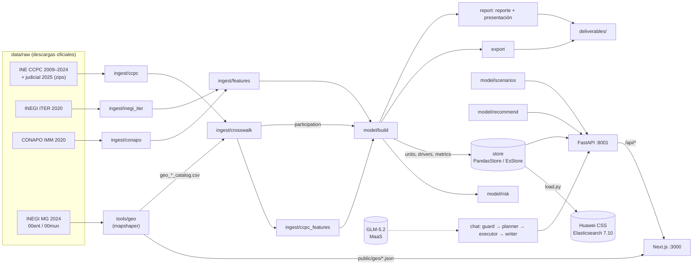

# ATALAYA — Riesgo de abstención en México

> **Fuente de verdad del proyecto.** Describe para qué sirve la app, cómo está construida y qué módulo implementa cada funcionalidad, tal como está hoy. Si el código y este documento discrepan, se corrige el que esté mal.

---

## 1. Propósito

Propuesta para el **Hackathon INE 2026 «Hackea la participación: Datos que construyen democracia»**, **Reto 2: Predicción y escenarios de riesgo de abstención** (analítica predictiva, sin datos personales).

- **Pregunta guía:** *¿Qué zonas podrían presentar mayor abstención en el futuro si no se interviene?*
- **Para qué le sirve al INE:** planeación anticipada y priorización estratégica de recursos rumbo a la elección federal del **6 de junio de 2027**.
- **Fuente obligatoria:** la convocatoria exige aprovechar la **Plataforma de Conteos Censales de Participación Ciudadana (CCPC) 2009–2024** del INE; ATALAYA la usa como fuente electoral única.

ATALAYA es un tablero y un conjunto de entregables que:

1. **Pronostica** la abstención de los **2,478 municipios** (Marco Geoestadístico INEGI 2024) y de los 32 estados para 2027.
2. **Clasifica** cada zona en un **semáforo** 🟢 verde · 🟡 amarillo · 🟠 naranja · 🔴 rojo que combina tendencia histórica y vulnerabilidad sociodemográfica, visible en un **mapa navegable** (país → estado → municipio).
3. **Simula escenarios**: *base* (sin intervención), *intervención* hipotética parametrizable y *pesimista*.
4. **Prioriza recursos** por **abstención esperada** (personas que se espera no voten) y propone **recomendaciones preventivas** por zona.
5. **Responde preguntas** con un asistente conversacional (GLM-5.2 en Huawei MaaS) que consulta los datos (Huawei CSS/Elasticsearch o memoria) y nunca inventa cifras.
6. **Genera los entregables del reto**: reporte metodológico (PDF), presentación ejecutiva (PDF), mapa de escenarios (GeoJSON) y base de datos anonimizada (XLSX/CSV).

**Principios:** solo datos agregados y disociados; supresión de celdas pequeñas; todo flujo con LLM tiene respaldo determinista; funciona sin conexión al clúster.

---

## 2. Arquitectura



| Capa | Tecnología | Ubicación |
|---|---|---|
| Ingesta y modelo | Python 3.12, pandas, numpy (sin scikit-learn) | `backend/atalaya/ingest`, `backend/atalaya/model` |
| Almacén de consulta | `PandasStore` (parquet en memoria) / `EsStore` (Huawei CSS = Elasticsearch 7.10.2) | `backend/atalaya/store.py` |
| API | FastAPI + SSE | `backend/atalaya/api` |
| Asistente | Reglas deterministas + GLM-5.2 vía MaaS (API compatible OpenAI) | `backend/atalaya/chat`, `backend/atalaya/llm.py` |
| Entregables | openpyxl, GeoJSON, SVG en Python, PDF con Chrome/Edge headless | `backend/atalaya/export.py`, `backend/atalaya/report` |
| Frontend | Next.js 16, React 19, Tailwind 4, MapLibre GL 5 (WebGL) | `frontend/src` |
| Mapa base | Esri World Dark Gray Canvas (teselas ráster sin llave); sin conexión el mapa usa el contorno propio de México | `frontend/src/lib/mapStyle.ts` |
| Geografía | mapshaper (Node) | `tools/geo` |
| Orquestación | PowerShell 5.1 | `scripts/*.ps1` |

---

## 3. Datos

### 3.1 Fuentes (`data/raw/`, no versionado; cómo obtenerlas en `README.md`)

| Carpeta | Contenido | Uso |
|---|---|---|
| `data/raw/ccpc/` | `DatosAbiertos_DECEyEC_ConteosCensales{2009,2012,2015,2018,2021,2024}.zip`, `…ConteosCensalesPJ2025.zip`, manual oficial | Participación por **sección × sexo × edad** (LN, SV, NV, NS) |
| `data/raw/inegi/` | `iter_00_cpv2020_csv.zip` | Población, edad, escolaridad, lengua indígena, servicios, internet, ruralidad |
| `data/raw/conapo/` | `IMM_2020.csv` | Marginación, analfabetismo, ingresos |
| `data/raw/geo/` | `00ent.*`, `00mun.*` (MG 2024, Lambert ITRF2008, latin-1) | Polígonos del mapa y catálogo canónico de municipios |

### 3.2 Definiciones clave

- **Participación CCPC = SV / (SV + NV)**: SV = registros con marca de voto, NV = sin marca, NS = no especificados (cuadernillo no disponible), excluidos. Reproduce el tablero oficial: nacional 44.06 / 62.08 / 47.07 / 62.37 / 51.84 / 59.67 % (2009–2024); judicial 2025 = 13.0 %.
- **Confiabilidad:** un municipio-año es confiable si `ns_rate = NS/LN ≤ 0.5` y participación ≥ 2 %; entre 0.3 y 0.5 es de baja confianza. Los no confiables (210 municipio-años federales) no se usan en el modelo y se muestran como "sin información confiable", nunca como 0 %.
- **Unidad canónica:** `cvegeo` (5 dígitos) del MG 2024; estado = `cve_ent`. El crosswalk INE→INEGI cubre el **100 %** de la lista nominal en todos los años.
- **Privacidad:** celdas edad × sexo con LN < 10 se suprimen (`suprimido=true`, conteos y tasa nulos); el sexo no binario solo se publica a nivel estatal y nacional.

### 3.3 Artefactos (`data/build/`, regenerables, no versionados)

| Archivo | Productor | Contenido |
|---|---|---|
| `participation_ine.parquet`, `ccpc_profile.parquet`, `ccpc_seccion.parquet` | `ingest/ccpc.py` | Agregados CCPC por municipio INE, por edad × sexo y por sección |
| `geo_mun_catalog.csv`, `geo_ent_catalog.csv` | `tools/geo/build_geo.mjs` | Catálogo canónico MG 2024 |
| `inegi_mun.parquet`, `conapo_mun.parquet`, `features.parquet` | `ingest/inegi_iter.py`, `conapo.py`, `features.py` | Variables sociodemográficas por `cvegeo` (2,478 filas; `new_since_2020` para municipios recientes) |
| `crosswalk.parquet`, `crosswalk_unmatched.csv` | `ingest/crosswalk.py` | Mapeo INE→INEGI (override → exacto → variantes → fuzzy) |
| `participation.parquet` | `ingest/crosswalk.py` | **Tabla canónica**: `cvegeo × año × elección` con LN, SV, NV, NS, `ns_rate`, `reliable`, `low_confidence` |
| `ccpc_profile_mun.parquet`, `ccpc_seccion_mun.parquet` | `ingest/crosswalk.py` | Perfil y secciones con `cvegeo` |
| `ccpc_features.parquet` | `ingest/ccpc_features.py` | Indicadores CCPC por municipio **y estado** (desde sumas) y elección: `pct_ln_18_34`, `part_18_34`, `gap_youth_pp`, `gap_sexo_pp`, `pct_ln_rural`, `ns_rate` |
| `units.parquet`, `drivers.parquet`, `metrics.json`, `model.json` | `model/build.py` | Pronóstico, semáforo, componentes, prioridad, factores y métricas |

Datos curados versionados en `data/seed/`: `states.csv` (estados y alias), `variables.csv` (catálogo para el asistente), `recommendations.csv` (reglas), `mun_crosswalk_overrides.csv`, `concurrencia_gubernatura.csv` (gubernaturas concurrentes 2009–2027; 17 en 2027).

---

## 4. Funcionalidades → módulos

### 4.1 Ingesta

| Qué hace | Dónde |
|---|---|
| Lectura robusta CSV/XLSX/ZIP (codificación, separador, fila de encabezado, normalización) | `ingest/common.py` → `read_table`, `norm_name`, `norm_col`, `pick_col`, `to_num`, `zpad`, `write_parquet` |
| CCPC: recorre los 32 CSV de cada zip con tipos fijos, agrega y descarta (≈ 9.8 M filas/año, ~11 s/año) | `ingest/ccpc.py` |
| Indicadores CCPC por municipio y estado | `ingest/ccpc_features.py` |
| ITER con `usecols` (nunca carga las 286 columnas); CONAPO con `CVE_MUN` sin cero inicial | `ingest/inegi_iter.py`, `ingest/conapo.py` |
| Universo MG 2024 + unión ITER/CONAPO | `ingest/features.py` |
| Crosswalk y tablas canónicas con confiabilidad | `ingest/crosswalk.py` |
| (Heredado, fuera del pipeline) resultados SICEE | `ingest/ine_results.py` |

### 4.2 Modelo de riesgo

**Pronóstico — participación relativa.** El nivel nacional cambia mucho entre elecciones y no es predecible con datos municipales, así que el modelo predice la **desviación** de cada municipio respecto a la media de la elección (`dev = 100·participación − media municipal`), usando solo municipio-años confiables (`model/panel.py`).

- **Candidatos** (`model/forecast.py`): `persist_l1` (desviación de la elección anterior), `persist_l2`, `mean_l1_l2` y `ridge` (rezagos + concurrencia con gubernatura + variables sociodemográficas y CCPC del año previo).
- **Backtest honesto:** entrena con T ≤ 2018 → prueba 2021; T ≤ 2021 → prueba 2024. Métricas: MAE (pp), RMSE, Spearman y acierto en el 20 % de mayor abstención. **Se elige el candidato de menor MAE promedio.**
- **Resultado actual:** gana `persist_l1` (MAE 5.95 / 6.05 pp; Spearman 0.84 / 0.81; acierto top-20 % 0.68 / 0.70). Los modelos con concurrencia y sociodemográficas no lo superan (el efecto de la concurrencia varía entre elecciones). Municipios sin rezago usan el siguiente candidato disponible (`fallback_model`).
- **Nivel 2027:** supuesto explícito = participación SV/(SV+NV) de la última intermedia confiable (2021, **51.84 %**); el pronóstico se **calibra** para que su agregado ponderado por LN sea exactamente ese nivel (`calibration_pp`). El semáforo compara zonas entre sí; el supuesto mueve el nivel absoluto, no el orden.
- **Intervalo:** ± 1.645·σ de los residuales del fold 2024.

**Perfil estructural — vulnerabilidad sociodemográfica.** Ridge de la desviación promedio en intermedias sobre variables de INEGI, CONAPO y CCPC. R² en validación cruzada aleatoria **0.32** (0.31 dentro de cada estado); el 47 % de la variación es entre estados, por lo que la validación que deja estados completos fuera da −0.08 (también se reporta). De aquí salen:
- `vulnerability_pp` (abstención relativa que predice el perfil de la zona),
- los **factores** por zona (`drivers.parquet`, contribución en pp a la abstención) y los coeficientes que muestra Metodología.

**CLI:** `python -m atalaya.model.build [--national-level X]`.

### 4.3 Semáforo

`model/risk.py` → `compute_risk`, `rescore`, `category_for`.

`risk_score = 100 · (0.50·rango(abstención pronosticada) + 0.20·rango(vulnerabilidad) + 0.15·rango(−tendencia) + 0.15·rango(volatilidad))`, rangos dentro de cada nivel. 🔴 ≥ 75 · 🟠 ≥ 55 · 🟡 ≥ 35 · 🟢 < 35 · ⚪ sin dato. Los componentes (`r_abs`, `r_vuln`, `r_trend`, `r_vol`) se guardan para explicar cada índice. `rescore` evalúa escenarios contra la distribución base.

Estado actual (base): 297 municipios rojos (12.9 % de la LN), 756 naranjas (49.5 %), 742 amarillos (29.2 %), 678 verdes (8.3 %), 5 sin dato.

### 4.4 Escenarios

`model/scenarios.py` → `SCENARIOS`, `default_params`, `simulate`.

| Escenario | Parámetros | Efecto |
|---|---|---|
| `base` | — | Pronóstico sin intervención |
| `intervencion` | `lever` (voto joven, casillas/traslado rurales, lenguas indígenas, campaña general; default voto joven), `targeting` (rojo / rojo+naranja / todos; default rojo+naranja), `effect_pp` 0–10 (default 3), `coverage` 0–100 % (default 100) | `Δ = efecto · cobertura · peso`, peso = variable de la palanca / su P75 (tope 1.5; 1 en campaña general); tope 98 % |
| `pesimista` | `shock_pp` 0–5 (default 2), `trend_amplifier` 0–100 % (default 50) | Empeora participación |

Las claves, rangos y defaults se publican en `/api/meta`; el frontend los toma de ahí (`lib/scenarioParams.ts`) y envía a cada escenario solo sus claves. Claves desconocidas se ignoran; valores fuera de rango ⇒ 422.

Resumen: zonas por color vs base, LN por color, votos adicionales/perdidos (`Δparticipación × LN`), cambio promedio en abstención y abstención esperada por escenario. Con los defaults: rojos 297 → 232, 1,053 municipios con Δ entre −4.5 y −0.9 pp, +1,744,296 votos.

### 4.5 Priorización y recomendaciones

- `abstencion_esperada = pred_abstention × lista_nominal`; `prioridad` = orden por abstención esperada dentro de zonas rojas y naranjas (encabezan Tijuana, Juárez, Puebla, León, Ecatepec).
- `model/recommend.py` + `data/seed/recommendations.csv`: 10 reglas (voto joven, accesibilidad de casillas, lenguas indígenas, educación cívica visual, difusión no digital, diagnóstico de caída sostenida, monitoreo por volatilidad, personas mayores, credencialización, coordinación en alta marginación) activadas por percentiles nacionales y por los factores de la zona; máximo 4 por zona. Un disparador por factor (`driver:<col>`) solo aplica si el valor de la zona está del lado desfavorable de la mediana nacional, según la columna `direction` (`low`/`high`) del CSV (p. ej. no sugiere difusión no digital a un municipio con buen acceso a internet).

### 4.6 Privacidad

`atalaya/privacy.py` → `suppress_small_cells` (LN < 10), `drop_nonbinary_below_state`. Se aplica en la API, el asistente y los entregables.

### 4.7 Almacén de consulta y Huawei CSS

`store.py` → `DataStore`, `PandasStore`, `EsStore`, `get_store`.

- Interfaz: `units`, `unit`, `participation`, `profile`, `search_units` (fuzzy y alias), `search_catalog`, `top`, `aggregate`, `correlation`, `drivers`, `metrics`, `stats`.
- `units` incluye columnas anchas `part_dip_<año>`/`abst_dip_<año>` para resolver correlaciones en un solo índice; métricas CCPC por año desde `ccpc_features`. Año por defecto: último federal (la judicial 2025 solo si se pide).
- **En CSS** (`schema.py`, plantillas legacy, prefijo `atalaya-`): índices `units`, `participation`, `catalog`, `profile`; búsqueda fuzzy con `multi_match`, agregaciones `terms/avg/percentiles` y **correlación con `matrix_stats`** dentro del clúster.
- `get_store()`: `ATALAYA_STORE=auto` usa CSS si responde en ≤ 3 s y existe `atalaya-units`; si no, memoria. Carga: `python -m atalaya.load [--dry-run]`. Diagnóstico: `backend/scripts/check_cluster.py`.

### 4.8 Asistente conversacional

`api/chat.py` (`POST /api/chat`, SSE) orquesta `chat/`:

| Paso | Qué hace | Dónde |
|---|---|---|
| Guardia | Rechaza sin LLM peticiones de datos personales y de preferencias partidistas | `chat/guard.py` |
| Plan | Reglas primero (años, estados/municipios, intent, métrica del catálogo; perfil por edad, juvenil, género, judicial, priorización); LLM (`chat_json`) solo si hace falta; respaldo a reglas | `chat/planner.py`, `chat/spec.py` |
| Ejecución | Sobre el store, sin LLM: ranking, lookup, compare, trend, correlation (r, n, quintiles), profile, scenario, explain_unit, catalog; aplica privacidad; los datos censales siempre se fechan en 2020 | `chat/executor.py` |
| Redacción | LLM en streaming (≤ 120 palabras, solo cifras de la tabla, fuente y año); si falla o lo bloquea el auditor de contenido, plantilla determinista (`degraded`) | `chat/writer.py` |

Eventos: `plan` → `data` → `token`… → `done {sources, degraded}`. Cliente LLM: `llm.py` (reintentos, razonamiento desactivado ≈ 4 s, detección del auditor de MaaS).

### 4.9 API REST

`api/main.py` (app, CORS, warmup), `api/routes.py`, `api/deps.py` (caches).

| Método | Ruta | Devuelve |
|---|---|---|
| GET | `/api/health` | estado, store, LLM, conteos |
| GET | `/api/meta` | año objetivo, años, estados, escenarios, categorías, fuentes de datos |
| GET | `/api/risk?level&ent&scenario` | zonas con pronóstico, semáforo, vulnerabilidad, abstención esperada, prioridad |
| POST | `/api/scenario/simulate` | items + resumen (422 con mensaje si los parámetros son inválidos) |
| GET | `/api/region/{id}?scenario` | serie (con `reliable`, `ns_rate`, judicial aparte), variables vs mediana, factores, componentes del índice, escenarios, recomendaciones, perfil CCPC 2009 vs 2024 (protegido), judicial 2025 |
| GET | `/api/ranking?level&ent&scenario&limit&sort=risk\|abstencion_esperada\|prioridad` | ranking |
| GET | `/api/metrics` | candidatos, modelo elegido, backtests, supuesto nacional, calibración, R² estructurales, confiabilidad |
| POST | `/api/admin/reload` | recarga datos |
| POST | `/api/chat` | SSE del asistente |

### 4.10 Frontend

Tablero oscuro de una sola pantalla en escritorio (el mapa llena su columna; el panel derecho hace scroll interno); lógica separada de presentación.

**Mapa de escenarios (MapLibre GL, WebGL).** Carga una vez los 32 estados y los 2,478 municipios de todo el país (`/api/risk?level=state|mun` sin `ent`) y colorea con *feature-state*, sin volver a subir geometría al cambiar de escenario. Los estados se ven en zoom bajo y los municipios aparecen al acercarse (fundido entre zoom 5 y 6). Al elegir un estado la cámara hace `fitBounds` y el resto del país se atenúa. Modos:

| Modo | Qué muestra |
|---|---|
| **Semáforo** | Categoría de riesgo del escenario activo |
| **Cambio Δ** | Intervención − base en pp de abstención (escala divergente: azul = menos abstención) |
| **Comparar** | Dos mapas sincronizados con cortina arrastrable: izquierda sin intervención, derecha con intervención; resumen "Rojo: 297 → 232 · N mejoran de categoría" |
| **3D** (conmutador) | Extrusión = abstención esperada (personas), escala √ fija entre escenarios; cámara inclinada |

El estado del mapa es compartible por URL: `?mapa=semaforo|delta|compare&3d=1&escenario=base|intervencion|pesimista`.

| Funcionalidad | Dónde |
|---|---|
| Estado global (escenario, parámetros, nivel, selección, simulación, salud, `mapMode`, `extrude3d`, `comparePos`, sincronía con la URL) | `src/lib/state.tsx` |
| Parámetros de escenario desde `Meta` (defaults, filtrado por escenario, descripción legible) | `src/lib/scenarioParams.ts` |
| Cliente API + SSE; mocks fieles al contrato real solo ante fallo de red | `src/lib/api.ts`, `src/lib/mocks/*` |
| GeoJSON del pipeline: estados, municipios por estado y nacional (`mun_all.json`), contorno (`country.json`), índice | `src/lib/geo.ts` |
| Datos del mapa: índices nacionales base y alterno, conteos por categoría, transiciones, escala 3D | `src/lib/mapRisk.ts`, `src/lib/useMapRisk.ts` |
| Estilo del mapa: ids de capas, mapa base, expresiones de color (categoría y Δ), alturas 3D, leyendas | `src/lib/mapStyle.ts` |
| Motor: capas (fondo, mapa base, contorno, rellenos, bordes, extrusiones, hover, selección, etiquetas), feature-state, hover, clic, cámara, 3D | `src/components/map/AtalayaMap.tsx`, `mapLayers.ts` |
| Cáscara del mapa: modos, comparador con cortina y cámara sincronizada, tooltip, leyenda (categorías o Δ), breadcrumb, buscador | `src/components/map/RiskMap.tsx`, `CompareSwipe.tsx`, `compareSync.ts`, `MapToolbar.tsx`, `MapTooltip.tsx`, `Legend.tsx`, `Breadcrumb.tsx`, `RegionSearch.tsx` |
| Selector de escenario y controles generados desde `Meta` | `src/components/layout/TopBar.tsx`, `ScenarioControls.tsx` |
| Detalle: semáforo, intervalo, serie (cortes por datos no confiables, judicial aparte), componentes del índice, perfil edad × sexo (celdas protegidas), indicadores CCPC, factores, recomendaciones, prioridad | `src/components/panel/RegionDetailPanel.tsx`, `src/components/viz/Sparkline.tsx` |
| Ranking ordenable (riesgo, abstención esperada, prioridad) y exportación CSV | `src/components/panel/RankingTable.tsx` |
| Asistente con streaming, tabla y fuente | `src/components/panel/ChatPanel.tsx` |
| Metodología: candidatos y backtests, supuesto nacional, R², confiabilidad, privacidad, fuentes | `src/app/metodologia/page.tsx` |

### 4.11 Entregables (`deliverables/`, generados)

| Entregable | Comando | Contenido |
|---|---|---|
| Base de datos anonimizada `base_datos_atalaya.xlsx` + `csv/` | `python -m atalaya.export` | Hojas `LEEME`, `diccionario`, `semaforo_ponderado`, `priorizacion`, `municipios`, `estados`, `participacion_historica`, `perfil_edad_sexo` (protegido), `drivers`, `recomendaciones`, `metricas_modelo`. Valida antes de exportar |
| Mapa de escenarios `mapa_escenarios_{municipal,estatal}.geojson` | `python -m atalaya.export` | Semáforo y abstención por escenario, factor y recomendación principal |
| Reporte metodológico `reporte_metodologico.{html,pdf}` (14 pp.) | `python -m atalaya.report.build_report` | Datos, modelo, semáforo, escenarios, recomendaciones, priorización, implementación, limitaciones |
| Presentación ejecutiva `presentacion_ejecutiva.{html,pdf}` (10 diapositivas) | `python -m atalaya.report.build_slides` | Mensajes clave con mapas y gráficas |

**Una sola fuente de cifras:** `report/facts.py` → `compute_facts` calcula todo número que aparece en reporte y presentación (categorías por escenario, LN en riesgo, transiciones base → intervención, parámetros reales de `SCENARIOS`, votos, perfil por edad con etiquetas exactas, modelo, prioridades, confiabilidad, privacidad), en crudo y formateado; las plantillas no calculan ni escriben cifras. Ambos documentos se presentan como **propuesta del equipo** (`--team`, `--repo-url`) y cada porcentaje indica su base (% de los municipios o % de la LN). La presentación falla (exit 2) si alguna tarjeta desborda su texto.

Gráficas en SVG generado en Python (`report/charts.py`: choropleth, mapa de transiciones con leyenda, líneas, barras) y PDF con Chrome/Edge headless (`html_to_pdf`).

### 4.12 Pipeline geográfico

`tools/geo/build_geo.mjs` (mapshaper): reproyecta a WGS84, simplifica (estados 2 %, municipios 4 %), escribe en `frontend/public/geo/` (versionado): `states.json`, `mun/<cve_ent>.json` (los usa `export.py`), `mun_all.json` (los 2,478 municipios en un archivo para el mapa nacional, ≈ 3.8 MB), `country.json` (contorno de México, respaldo sin conexión del mapa base), `index.json` (bbox y centroides), y los catálogos geo de `data/build/`.

---

## 5. Cómo correrlo

```powershell
# Pipeline completo: geo → CCPC → INEGI/CONAPO → features → crosswalk → CCPC features → modelo → export → validación
powershell -ExecutionPolicy Bypass -File scripts\build_all.ps1 [-SkipGeo] [-SkipModel] [-SkipExport] [-SkipReports] [-Load]
# Reporte y presentación (después del pipeline)
cd backend; python -m atalaya.report.build_report; python -m atalaya.report.build_slides
# Demo (API :8001 + web :3000; PIDs en data/cache/*.pid)
powershell -ExecutionPolicy Bypass -File scripts\start_demo.ps1      # -Mock: solo frontend con datos de demostración
powershell -ExecutionPolicy Bypass -File scripts\stop_demo.ps1
# Acceso público: una ventana de Windows Terminal con dos paneles (API | web); solo se publica el puerto web
powershell -ExecutionPolicy Bypass -File scripts\start_public.ps1 [-Port 3000] [-Rebuild] [-NoFirewall]
# Pruebas (sin red; una guardia impide que escriban en datos reales)
cd backend;  python -m pytest -q          # 216 pruebas
cd frontend; npm run typecheck; npm test; npm run build   # 84 pruebas
cd tools/geo; npm test
```

`build_all.ps1` termina con un resumen de validación (falla si la participación nacional 2024 no está en 59.6–59.7 %) y, salvo `-SkipReports`, genera reporte y presentación.

Configuración: `backend/.env` (plantilla `backend/.env.example`): `ES_URL`, `ES_USERNAME`, `ES_PASSWORD`, `ES_INSECURE`, `MAAS_API_KEY`, `MAAS_BASE_URL`, `MAAS_MODEL=glm-5.2`, `ATALAYA_INDEX_PREFIX=atalaya-`, `ATALAYA_STORE=auto|es|memory`, `ATALAYA_LLM_ENABLED`, `ATALAYA_TARGET_YEAR=2027`.

---

## 6. Estructura del repositorio

```
backend/atalaya/
  config.py  es_client.py  llm.py  schema.py  store.py  load.py  privacy.py  export.py
  ingest/   common · ccpc · ccpc_features · inegi_iter · conapo · features · crosswalk · ine_results (heredado)
  model/    panel · forecast · build · risk · scenarios · recommend
  api/      main · routes · deps · chat
  chat/     spec · guard · planner · executor · writer
  report/   facts · charts · build_report · build_slides · templates/ · slides_templates/
backend/scripts/   check_cluster.py · smoke_llm.py · validate_build.py
backend/tests/     216 pruebas offline
frontend/src/      app/ · components/{map,panel,layout,viz} · lib/{api,state,geo,format,types,scenarioParams,mapStyle,mapRisk,useMapRisk,mocks}
frontend/public/geo/   capas GeoJSON generadas (versionadas)
tools/geo/         build_geo.mjs + pruebas
data/seed/         catálogos y reglas curadas
scripts/           build_all · start_demo · start_public · stop_demo · run-safe
AGENTS.md · .agent-guard.json   reglas para agentes automatizados
```

---

## 7. Garantías de privacidad y veracidad

- Solo información **agregada y disociada**; supresión de celdas con menos de 10 personas; sexo no binario solo a nivel estatal/nacional; el asistente rechaza solicitudes de datos personales.
- Sin análisis de preferencias políticas, partidos ni candidaturas.
- Toda cifra del asistente y de los entregables se calcula de los artefactos; el LLM solo planea y redacta.
- Los escenarios se presentan como **supuestos hipotéticos**; el nivel nacional 2027 es un **supuesto explícito**; el pronóstico lleva intervalo.

---

## 8. Limitaciones

- La persistencia relativa gana porque las condiciones de cada elección (concurrencias locales, contexto) cambian; el modelo no anticipa choques locales nuevos.
- Variables censales estáticas (2020); municipios creados después de 2020 usan imputación por mediana estatal (`imputed_census`) y solo tienen historia desde que existen.
- Municipio-años con muchos registros no especificados quedan fuera del modelo.
- Los factores son asociaciones estructurales (R² ≈ 0.3), no efectos causales.
- El clúster Huawei CSS solo es accesible desde la VPC; fuera de ella la app usa el almacén en memoria con el mismo comportamiento.

---

## 9. Estado actual

**Funcional y probado con datos reales:** ingesta CCPC/INEGI/CONAPO, crosswalk al 100 %, modelo con backtest y selección honesta, semáforo con vulnerabilidad, escenarios (con los parámetros reales de la API), priorización, recomendaciones con dirección desfavorable, privacidad, API, asistente, mapa WebGL (semáforo, Δ, comparador con cortina, 3D; verificado en Chrome con capturas y mediciones), exportación, y reporte y presentación con cifras únicas desde `facts.py`.

**Pendiente:**
1. Cargar a Huawei CSS desde una máquina dentro de la VPC y probar `EsStore` con datos reales.
2. Pulido visual menor del tablero: atribución y controles de zoom con el estilo oscuro, etiqueta "Intervención" con acento en el panel de diagnóstico.
3. Completar el nombre definitivo del equipo y la URL pública del repositorio en reporte y presentación (hoy: defaults `OXENT` y el repositorio de GitHub).
