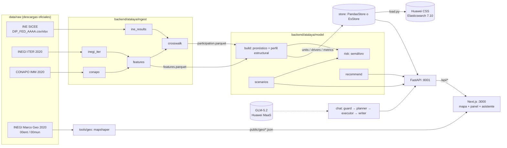

# ATALAYA — Riesgo de abstención en México

> **Fuente de verdad del proyecto.** Explica para qué sirve la app, cómo está construida y qué módulo implementa cada funcionalidad. Si el código y este documento discrepan, se corrige el que esté mal.
>
> Estado al 2026-10-04: Olas 1, 2 y 2-fix completas y auditadas (commits `1470d37`, `ca48fa4`, `604115c`). **Pendiente Ola 3:** corrida con datos reales, mapas reales, carga al clúster CSS. Ver [§10](#10-estado-actual-y-pendientes).

---

## 1. Propósito

Hackathon INE — **Reto 2: Predicción y escenarios de riesgo de abstención** (analítica predictiva, sin datos personales).

**Pregunta guía:** *¿Qué zonas podrían presentar mayor abstención en el futuro si no se interviene?*
**Para qué le sirve al INE:** planeación anticipada y priorización estratégica de recursos.

ATALAYA es un tablero para personal del INE que:

1. **Pronostica** la abstención de cada municipio y estado para la elección federal de **2027** (diputaciones federales), a partir de la participación histórica 2009–2024 y de variables sociodemográficas agregadas (INEGI Censo 2020, CONAPO marginación 2020).
2. **Traduce el pronóstico a un semáforo** territorial fácil de leer: 🟢 verde, 🟡 amarillo, 🟠 naranja, 🔴 rojo, en un **mapa navegable** de México (estados → municipios, zoom/pan tipo Google Maps).
3. **Simula escenarios**: *sin intervención* (base), *con intervención hipotética* (parametrizable) y *pesimista*. Muestra cuántas zonas cambian de color y cuántos votos se ganarían o perderían.
4. **Propone recomendaciones preventivas** por zona, derivadas de los factores que más empujan su abstención.
5. **Responde preguntas específicas** con un asistente conversacional (LLM GLM-5.2 en Huawei MaaS). Planea una consulta estructurada, la ejecuta sobre los datos (Huawei CSS/Elasticsearch o memoria) y redacta la respuesta citando fuente y año. **Nunca inventa cifras.**

**Principios:** solo datos **agregados** (municipio o mayor, nunca padrón nominativo); todo flujo con LLM tiene **respaldo determinista**; la app funciona **sin conexión** al clúster.

---

## 2. Arquitectura



| Capa | Tecnología | Ubicación |
|---|---|---|
| Ingesta y modelo | Python 3.12, pandas, numpy (sin scikit-learn) | `backend/atalaya/ingest`, `backend/atalaya/model` |
| Almacén de consulta | `PandasStore` (parquet en memoria) / `EsStore` (Huawei CSS = Elasticsearch 7.10.2) | `backend/atalaya/store.py` |
| API | FastAPI + SSE (`sse-starlette`) | `backend/atalaya/api` |
| Asistente | GLM-5.2 vía MaaS (API compatible con OpenAI) + reglas deterministas | `backend/atalaya/chat`, `backend/atalaya/llm.py` |
| Frontend | Next.js 16, React 19, Tailwind 4, Leaflet/react-leaflet | `frontend/src` |
| Geografía | mapshaper (Node), shapefiles INEGI → GeoJSON simplificado | `tools/geo` |
| Orquestación | PowerShell 5.1 | `scripts/*.ps1` |

Puertos: backend **8001**, frontend **3000**.

---

## 3. Datos: fuentes y flujo

### 3.1 Fuentes (el usuario las coloca en `data/raw/`; nombres obligatorios)

| Carpeta | Archivo | Origen | Uso |
|---|---|---|---|
| `data/raw/ine/` | `DIP_FED_<AAAA>.<csv\|xlsx\|xls\|zip>` (2009…2024); opcional `PRES_*`, `SEN_*`, `PJF_2025` | INE **SICEE** (sicee.ine.mx), nivel municipio | Serie de participación |
| `data/raw/inegi/` | `iter_00_cpv2020_csv.zip` (o `.csv`) | INEGI Censo 2020, ITER nacional | Variables sociodemográficas |
| `data/raw/conapo/` | `IMM_2020.<csv\|xlsx>` | CONAPO Índice de marginación municipal 2020 | Marginación, analfabetismo, ingresos |
| `data/raw/geo/` | `00ent.*`, `00mun.*` (shp, shx, dbf, prj, cpg) | INEGI Marco Geoestadístico 2020 | Polígonos del mapa |

El **año y tipo de elección** se leen del nombre del archivo (regex `(DIP_FED|PRES|SEN|PJF)_(\d{4})`).

### 3.2 Claves geográficas

- `cve_ent` (2 dígitos) — INE e INEGI comparten numeración de estados.
- `cvegeo` (5 dígitos = `cve_ent + cve_mun`) — **ID canónico de municipio** en modelo, mapa y API.
- El INE numera municipios distinto que INEGI: el **crosswalk** los une por nombre normalizado (ver §4.1).
- ID de región en la API: `"07"` = estado, `"07101"` = municipio.

### 3.3 Artefactos (`data/build/`, no versionados)

| Archivo | Lo produce | Contenido |
|---|---|---|
| `participation_ine.parquet` | `ingest/ine_results.py` | Participación por municipio **INE** × elección × año |
| `inegi_mun.parquet` | `ingest/inegi_iter.py` | Indicadores ITER por municipio |
| `conapo_mun.parquet` | `ingest/conapo.py` | Marginación CONAPO por municipio |
| `features.parquet` | `ingest/features.py` | Unión INEGI + CONAPO por `cvegeo` |
| `crosswalk.parquet`, `crosswalk_unmatched.csv` | `ingest/crosswalk.py` | Mapeo INE→INEGI y pendientes de revisión |
| `participation.parquet` | `ingest/crosswalk.py` | **Tabla canónica** de participación por `cvegeo` |
| `units.parquet` | `model/build.py` | Una fila por municipio y por estado con features, pronóstico, riesgo y semáforo |
| `drivers.parquet` | `model/build.py` | Top 5 factores por unidad (pp de abstención) |
| `metrics.json`, `model.json` | `model/build.py` | Backtests, coeficientes, lambda, R² estructural |

Datos versionados curados a mano: `data/seed/states.csv` (32 estados + alias como CDMX/Edomex), `data/seed/variables.csv` (catálogo de 21 variables para el asistente), `data/seed/recommendations.csv` (10 reglas de recomendación), `data/seed/mun_crosswalk_overrides.csv` (correcciones manuales del crosswalk).

---

## 4. Funcionalidades → módulos y código

### 4.1 Ingesta robusta de Excel/CSV oficiales

| Qué hace | Dónde |
|---|---|
| Lectura de `.csv/.txt/.xlsx/.xls/.zip` con detección de codificación (utf-8-sig → cp1252 → latin-1, decodificador incremental), separador (`, \| ; \t`) y **fila de encabezado** (busca alias en las primeras 30 filas); normalización de columnas y nombres | `ingest/common.py` → `read_table`, `norm_col`, `norm_name`, `pick_col`, `to_num`, `zpad` |
| Resultados INE: descubre archivos por nombre, resuelve columnas por alias (ID/nombre de entidad y municipio, lista nominal, votos totales), excluye voto en el extranjero y totales, agrega a municipio, `participacion = votos/lista` recortada a ≤1 | `ingest/ine_results.py` → `discover_files`, `resolve_municipio_columns`, `get_entity_series`, `process_file`, `ingest_ine_results` |
| ITER: lee solo las columnas necesarias (archivo ~1.6 GB), filas municipales (`LOC=0`) y `pct_rural` desde localidades < 2,500 hab. | `ingest/inegi_iter.py` → `process_inegi_iter` |
| CONAPO: `CVE_MUN` de 5 o 3 dígitos, grado de marginación normalizado | `ingest/conapo.py` → `process_conapo`, `normalize_gm` |
| Variables por municipio (`pct_18_24`, `graproes`, `pct_hli`, `pct_internet`, `pct_rural`, `pct_analfabeta`, `im_2020`, …) | `ingest/features.py` → `process_features` |
| Crosswalk INE↔INEGI dentro de cada estado: override → exacto → variantes (quita "Heroica Ciudad de", `GRAL`↔`GENERAL`…) → fuzzy (`difflib` ≥ 0.88 con margen 0.03) → no mapeado (CSV para revisión). Reporta % de lista nominal cubierta | `ingest/crosswalk.py` → `strip_variants`, `load_overrides`, `process_crosswalk` |

### 4.2 Modelo de riesgo (explicable, sin datos personales)

Dos modelos con propósitos distintos, ambos **ridge en forma cerrada con numpy**:

| Modelo | Objetivo | Predictores | Para qué se usa | Dónde |
|---|---|---|---|---|
| **Pronóstico** | participación DIP_FED en el año T | `lag1` (elección anterior, tipo opuesto), `lag2` (elección del mismo tipo, T−6), `pres` (año presidencial) + 11 features estandarizadas | `pred_participation`/`pred_abstention` 2027 e intervalo | `model/forecast.py` → `fit_ridge`, `predict`; `model/panel.py` → `training_rows` |
| **Perfil estructural** | participación promedio en elecciones intermedias | las 11 features | **Explicar**: drivers por zona y coeficientes de Metodología | `model/forecast.py` → `fit_structural`, `contributions_structural`; `model/panel.py` → `intermediate_turnout` |

¿Por qué dos? En el pronóstico, los rezagos absorben el nivel de cada municipio y las features quedan con coeficiente ≈ 0, así que no explican nada. El perfil estructural aísla la asociación entre características del territorio y participación.

- **Features:** `pct_18_24, pct_65ymas, graproes, pct_hli, pct_sin_servsalud, pct_internet, pct_rural, pct_analfabeta, pct_po2sm, coverage_ln` (lista nominal / población 18+), `log_pob_18ymas`. Imputación con medianas de entrenamiento.
- **Backtest honesto:** entrena con T ≤ 2018 → prueba 2021; T ≤ 2021 → prueba 2024. MAE/RMSE en pp, Spearman y comparación contra **persistencia** (repetir la elección anterior del mismo tipo). Lambda elegida con el fold 2021 (`select_lambda`); R² del perfil estructural por validación cruzada agrupada por estado.
- **Tendencia y volatilidad** por unidad: OLS `participación ~ 1 + k + pres` (`panel.unit_trend`).
- **Intervalo:** `pred_abstention ± 1.645·σ` (σ = residuales del último fold).
- **Nivel estatal:** agregación ponderada por lista nominal (`model/build.py`).
- CLI: `python -m atalaya.model.build` → `units.parquet`, `drivers.parquet`, `metrics.json`, `model.json`.

> Resultado en datos sintéticos de auditoría (2,400 municipios): MAE 2.6 pp vs 3.3 pp de persistencia, Spearman 0.92. El perfil estructural recuperó los efectos plantados (escolaridad +2.5 pp/DE, jóvenes −1.3 pp/DE). **Pendiente validar con datos reales.**

### 4.3 Semáforo de riesgo

`model/risk.py` → `compute_risk`, `rescore`, `category_for`.

- `risk_score = 100 · (0.60·rango(abstención pronosticada) + 0.25·rango(−tendencia) + 0.15·rango(volatilidad))`, con rangos percentiles **dentro de cada nivel** (municipios contra municipios, estados contra estados).
- 🔴 rojo ≥ 75 · 🟠 naranja ≥ 55 · 🟡 amarillo ≥ 35 · 🟢 verde < 35 · ⚪ `sin_dato`.
- `rescore` evalúa un escenario **contra la distribución base**, para que los cambios de color sean comparables.

### 4.4 Escenarios

`model/scenarios.py` → `SCENARIOS`, `default_params`, `simulate`.

| Escenario | Parámetros | Efecto |
|---|---|---|
| `base` | — | Pronóstico sin intervención |
| `intervencion` | `lever` (promoción del voto joven, casillas/traslado rurales, materiales en lenguas indígenas, campaña general), `targeting` (rojo / rojo+naranja / todos), `effect_pp` (0–10), `coverage` (0–100 %) | `Δ = effect·coverage·w`. El peso `w` es la variable de la palanca entre su P75 nacional, recortada a [0, 1.5]; vale 1 en campaña general. Tope de participación: 98 %. |
| `pesimista` | `shock_pp` (0–5), `trend_amplifier` (0–100 %) | Caída general + acentuación de tendencias negativas |

Resumen: conteo por semáforo vs base, **votos adicionales/perdidos** (`Δparticipación × lista nominal`) y cambio promedio en abstención ponderado (negativo = mejora). Todos los supuestos se presentan como **hipotéticos**.

### 4.5 Recomendaciones preventivas

`model/recommend.py` → `build_reference`, `recommend`, con reglas en `data/seed/recommendations.csv`.

10 reglas: voto joven, accesibilidad de casillas rurales, materiales en lenguas indígenas, educación cívica visual, difusión fuera de canales digitales, diagnóstico de caída sostenida, monitoreo por volatilidad, accesibilidad para personas mayores, credencialización y coordinación en alta marginación. Se activan por percentiles nacionales (p. ej. `pct_18_24 ≥ P75`) o porque la variable es un **driver** que sube la abstención. Los textos llevan las cifras de la zona; la prioridad depende del semáforo. Máximo 4 por zona.

### 4.6 Almacén de consulta y Huawei CSS

`store.py` → `DataStore` (protocolo), `PandasStore`, `EsStore`, `get_store`.

- Interfaz: `units`, `unit`, `participation`, `search_units` (fuzzy por nombre y alias), `search_catalog`, `top`, `aggregate`, `correlation`, `drivers`, `metrics`, `stats`.
- `units` incluye columnas anchas `part_dip_<año>` / `abst_dip_<año>`, para que las correlaciones participación × variable se resuelvan en un solo índice.
- **En CSS**: índices con prefijo `atalaya-` (`units`, `participation`, `catalog`, plantillas *legacy* en `schema.py`). `search_units` usa `multi_match` con `fuzziness`, `aggregate` usa agregaciones `terms/avg/percentiles` y **`correlation` usa `matrix_stats`**: la correlación se calcula dentro del clúster.
- `get_store()`: `ATALAYA_STORE=auto` usa CSS si responde en ≤ 3 s y existe `atalaya-units`; si no, cae a memoria.
- Carga: `python -m atalaya.load [--dry-run]` (`load.py` → `prepare_*_docs`, `validate_docs`). Solo borra o recrea índices `atalaya-*`.
- Cliente y conexión: `es_client.py` (`get_es`, `ping_es`, `ensure_templates`, `bulk_index`); diagnóstico: `backend/scripts/check_cluster.py`.

### 4.7 Asistente conversacional

`api/chat.py` (`POST /api/chat`, SSE) orquesta el paquete `chat/`:

| Paso | Qué hace | Dónde |
|---|---|---|
| 1. Guardia | Rechaza sin LLM las solicitudes de datos personales (CURP, clave de elector, domicilios) y las de preferencias por partido o candidato | `chat/guard.py` → `check` |
| 2. Plan | Primero **reglas** (año, estados/municipios vía `search_units`, intent por palabras clave, métrica vía catálogo); si no hay confianza, LLM con `chat_json` → `QuerySpec`. Si falla, vuelve a reglas | `chat/planner.py` → `plan`; `chat/spec.py` → `QuerySpec`, `DataResult` |
| 3. Ejecución | Sin LLM, sobre el store: ranking, lookup, compare, trend, correlation (r, n, fuerza y tabla por quintiles; "correlación no implica causalidad"), scenario (`simulate`), explain_unit (drivers + recomendaciones), catalog | `chat/executor.py` → `execute` |
| 4. Redacción | LLM en streaming (≤ 120 palabras, solo cifras de la tabla, cita fuente y año). Si el LLM falla o lo bloquea el auditor de contenido, usa una plantilla determinista y marca `degraded` | `chat/writer.py` → `stream_answer`, `fallback_text` |

Eventos SSE: `plan` → `data` (tabla + fuente) → `token`… → `done {sources, degraded}` (o `error`).
Cliente LLM: `llm.py` (`chat`, `chat_stream`, `chat_json`): reintentos, `thinking` desactivado (~4 s por respuesta corta) y detección del auditor de contenido de MaaS (HTTP 403, `content_filter`, aviso anexado al final).

### 4.8 API REST

`api/main.py` (app, CORS, warmup en segundo plano, incluye el router de chat si existe), `api/routes.py` (endpoints), `api/deps.py` (caches de units, simulaciones LRU y referencia de recomendaciones).

| Método | Ruta | Devuelve |
|---|---|---|
| GET | `/api/health` | estado, store (`es`/`memory`), LLM, warmup, conteos |
| GET | `/api/meta` | año objetivo, años, estados, definición de escenarios y categorías |
| GET | `/api/risk?level=state\|mun&ent=&scenario=` | `RiskItem[]` para colorear el mapa |
| POST | `/api/scenario/simulate` | items + resumen del escenario (422 si los parámetros son inválidos) |
| GET | `/api/region/{id}?scenario=` | detalle: serie histórica, features vs mediana nacional, drivers, escenarios, recomendaciones |
| GET | `/api/ranking?level=&ent=&scenario=&limit=` | zonas ordenadas por `risk_score` |
| GET | `/api/metrics` | backtests, coeficientes estructurales y de pronóstico, fuentes |
| POST | `/api/admin/reload` | recarga el store tras reconstruir datos |
| POST | `/api/chat` | SSE del asistente |

Documentación interactiva: `http://localhost:8001/docs`.

### 4.9 Frontend

UX deliberadamente simple: un experto de diseño rehará la UI. La lógica de datos está separada de la presentación.

| Funcionalidad | Dónde |
|---|---|
| Estado global (escenario y parámetros, nivel, estado y región seleccionados, simulación, salud de la API) | `src/lib/state.tsx` → `AtalayaProvider`, `useAtalaya` |
| Cliente API + parser SSE + respaldo a mocks **solo** ante fallo de red, 5xx o endpoint inexistente | `src/lib/api.ts` → `getHealth`, `getMeta`, `getRisk`, `simulateScenario`, `getRegion`, `getRanking`, `getMetrics`, `streamChat`, `parseSSEChunk` |
| Carga de GeoJSON con contrato del pipeline (`id/name/ent`) y adaptador de `index.json` | `src/lib/geo.ts` → `toIndexItems`, `fetch*` |
| Mapa: estados coloreados por semáforo → clic o zoom → municipios del estado; tooltip, vuelta a nacional al alejar | `src/components/map/RiskMap.tsx` (carga dinámica sin SSR), `LeafletInnerMap.tsx` |
| Leyenda con conteos, breadcrumb México › Estado › Municipio, buscador de zonas | `Legend.tsx`, `Breadcrumb.tsx`, `RegionSearch.tsx` |
| Barra superior: selector de escenario, banner sin datos / datos de demostración | `src/components/layout/TopBar.tsx` |
| Controles de intervención generados desde `Meta.scenarios[].params` + resumen con signo | `src/components/layout/ScenarioControls.tsx` |
| Panel Detalle (semáforo, intervalo, tendencia, serie histórica, features, drivers, recomendaciones) | `src/components/panel/RegionDetailPanel.tsx`, `src/components/viz/Sparkline.tsx` |
| Ranking con filtro y exportación CSV en el navegador | `src/components/panel/RankingTable.tsx` |
| Asistente: streaming, tabla con fuente, "Cómo lo calculé", aviso `degraded`, detener, contexto de región | `src/components/panel/ChatPanel.tsx` |
| Página de metodología (fuentes, backtests vs persistencia, coeficientes, supuestos, limitaciones) | `src/app/metodologia/page.tsx` |
| Mocks deterministas para demo sin backend (`NEXT_PUBLIC_MOCK=1`) | `src/lib/mocks/*` |

### 4.10 Pipeline geográfico

`tools/geo/build_geo.mjs` (mapshaper): reproyecta INEGI (Lambert ITRF2008) a WGS84 y simplifica (estados 2 %, municipios 4 %). Genera `frontend/public/geo/states.json`, `mun/<cve_ent>.json` (uno por estado) e `index.json` (bbox y centroides). Límites de tamaño: estados ≤ 1.5 MB, cada estado ≤ 800 KB.

---

## 5. Cómo correrlo

```powershell
# 1. Pipeline completo (ingesta → modelo → validación; -Load sube a CSS, -Geo genera mapas)
powershell -ExecutionPolicy Bypass -File scripts\build_all.ps1 [-Load] [-Geo] [-SkipModel]

# 2. Demo (API :8001 + web :3000, procesos desacoplados, PIDs en data/cache/*.pid)
powershell -ExecutionPolicy Bypass -File scripts\start_demo.ps1        # -Mock: solo frontend con datos de demostración
powershell -ExecutionPolicy Bypass -File scripts\stop_demo.ps1

# 3. Pruebas
cd backend;  python -m pytest -q                 # 133 pruebas, sin red
cd frontend; npm run typecheck; npm test; npm run build
cd tools/geo; npm test
```

Configuración: `backend/.env` (no versionado; plantilla en `backend/.env.example`): `ES_URL`, `ES_USERNAME`, `ES_PASSWORD`, `ES_INSECURE`, `MAAS_API_KEY`, `MAAS_BASE_URL`, `MAAS_MODEL=glm-5.2`, `ATALAYA_INDEX_PREFIX=atalaya-`, `ATALAYA_STORE=auto|es|memory`, `ATALAYA_LLM_ENABLED`, `ATALAYA_TARGET_YEAR=2027`.

---

## 6. Estructura del repositorio

```
backend/
  atalaya/
    config.py  es_client.py  llm.py  schema.py  store.py  load.py
    ingest/    common · ine_results · inegi_iter · conapo · features · crosswalk
    model/     panel · forecast · build · risk · scenarios · recommend
    api/       main · routes · deps · chat
    chat/      spec · guard · planner · executor · writer
  scripts/     check_cluster.py · smoke_llm.py
  tests/       133 pruebas offline (conftest bloquea el cliente ES)
frontend/src/  app/ · components/{map,panel,layout,viz} · lib/{api,state,geo,format,types,mocks}
tools/geo/     build_geo.mjs (mapshaper) + pruebas
data/seed/     states · variables · recommendations · mun_crosswalk_overrides
scripts/       build_all · start_demo · stop_demo · run-safe
AGENTS.md · .agent-guard.json   reglas y guard para agentes automatizados
```

---

## 7. Garantías de privacidad y de veracidad

- Solo información **agregada y disociada** (municipio, estado). No se procesa padrón nominativo; el asistente rechaza solicitudes de datos personales.
- El asistente **no** analiza preferencias políticas, partidos ni candidatos.
- Toda cifra del asistente sale de la tabla del executor; el LLM solo planea y redacta. Sin LLM, la app responde con plantillas deterministas.
- Escenarios e impactos de intervención se presentan como **supuestos hipotéticos**; el pronóstico se muestra con intervalo.

---

## 8. Limitaciones conocidas

- Variables sociodemográficas **estáticas** (Censo 2020) usadas para todos los años.
- Municipios creados después de 2020 se agregan a su municipio padre mediante overrides del crosswalk.
- La predicción supone continuidad institucional (la elección judicial 2025 se excluye del modelo).
- Correlación ≠ causalidad: los drivers son asociaciones estructurales, no efectos causales.

---

## 9. Forma de trabajo (desarrollo por olas)

El código lo implementan agentes Gemini en paralelo (máximo 5 por ola), con propiedad de archivos disjunta, a partir de planes en `temp/atalaya/` (local, no versionado). El arquitecto audita cada ola (pruebas completas + corrida de punta a punta con datos sintéticos), escribe planes de corrección y hace los commits. Los agentes no usan git ni escriben reportes. Sus comandos pasan por el hook `agent-guard` (`AGENTS.md`, `.agent-guard.json`).

---

## 10. Estado actual y pendientes

**Hecho y auditado:** ingesta robusta, crosswalk, pronóstico + perfil estructural con backtests, semáforo, 3 escenarios, recomendaciones, store dual memoria/CSS, API completa, asistente con guardia/reglas/LLM/respaldo, frontend conectado a la API, pipeline geo y scripts de demo.

**Pendiente (Ola 3):**
1. Recibir los datos reales en `data/raw/` y ajustar la lectura a sus encabezados; llenar overrides del crosswalk (meta: ≥ 99 % de lista nominal cubierta por año); validar cifras nacionales (p. ej. DIP_FED 2021 ≈ 52–53 %).
2. Generar mapas reales con `tools/geo` y verificar en navegador el drill-down con polígonos INEGI (hoy el frontend usa geometría de demostración).
3. Cargar a Huawei CSS desde una máquina con acceso a la VPC y probar `EsStore` (desde la VM de desarrollo el clúster no responde).
4. Bugs menores detectados: `start_demo.ps1` aborta si encuentra una demo previa cuyo proceso ya terminó (`taskkill` + `$ErrorActionPreference="Stop"` en PS 5.1); el asistente puede atribuir un dato del Censo 2020 al año mencionado en la pregunta.
5. Rediseño visual del frontend (experto de UI).
